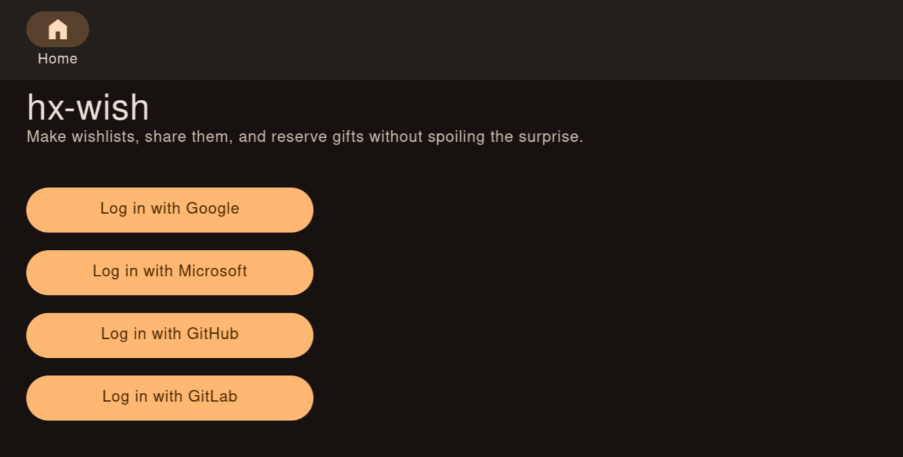
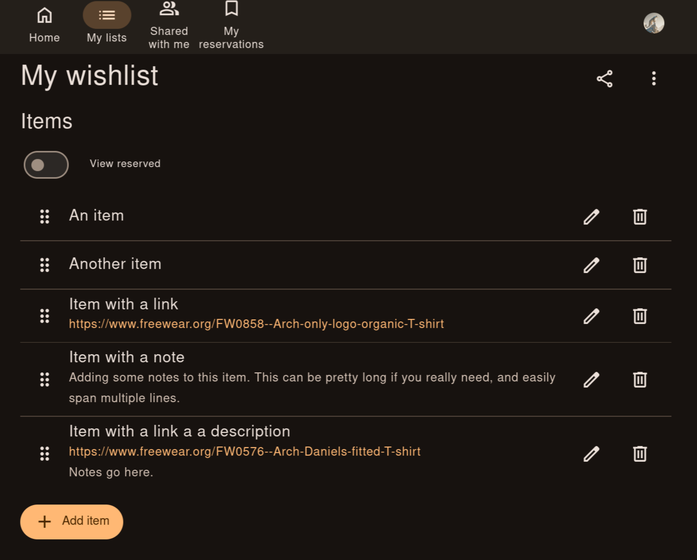
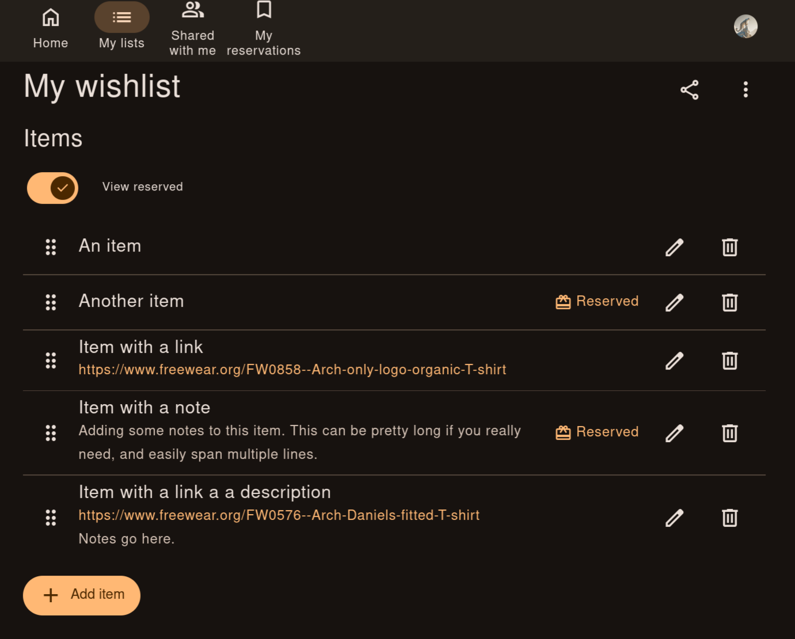
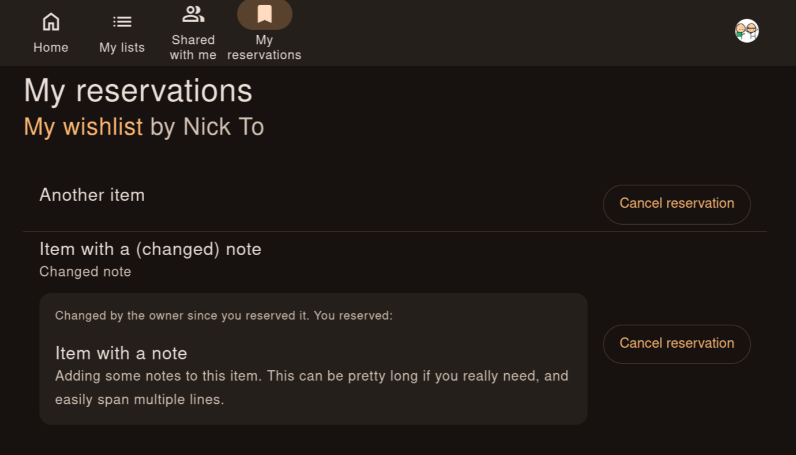
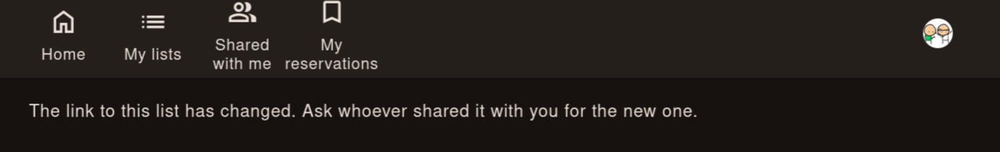

## Why a wishlist?

Wishlists make gift-giving easier. Givers don't have to guess, and recipients
get something they actually want instead of another dust collector.

But what about surprises? If the list is long enough, you don't know exactly
what you'll get or from whom, so there is still plenty of room for surprise.
And if you'd rather not pick a gift from someone's wishlist, nobody forces you
to.

## What I need

These were my requirements before I started building my own solution.

**No new accounts.** Lists should be shareable via a public link or via OIDC
with a provider that basically everyone already has. If people have to register
on yet another service, the chances that they will actually use it are slim.

**Reserving and releasing items.** Publishing a static list is easy, but not
very useful: givers need to mark what they are getting.

- Reservations are visible to other givers, so two people don't buy the same
  thing.
- Reservations are hidden from the list owner, so they can still be surprised.
- Reservations can be released. It has happened to me more than once that I
  settled on a gift but couldn't find it anywhere and had to give up on it.

**Simple.** Minimalistic in both UI and functionality.

**Maintained.** Duh.

## Existing solutions

I have a homelab running k3s. And a bunch of services there use Helm charts by
[TrueCharts](https://truecharts.org/), so naturally, it was the first place I
checked. But there was no single wishlist app.

So I turned to Google. The first time I looked was a few years ago, back when
people still searched instead of asking an LLM. Wishlists seem to be one of the
most popular hobby projects, right after calculators and weather apps. Yet only
a couple of them look like genuinely polished, general-purpose apps: most target
one specific use case.



### [Wishlist](https://github.com/cmintey/wishlist) by cmintey

672 stars. Wishlists for friends and family. Everyone has an account, and users
are organised into groups where members see each other's lists and claim items.
Lists can also be shared through a public link. Other features include product
details fetched from a URL and OIDC login.

Honestly, had I found it the first time I looked, I would probably have been
satisfied. Still, a few things make it not quite what I want.

What I liked: it's the most complete of the lot and actively developed by many
contributors. Claiming and unclaiming are one click, quantities are handled
properly, and claims are hidden from owners by default.

Why it's not for me:

- Whether owners see claims is a single global admin setting, not the owner's
  choice: once it's on, every owner sees what has been claimed.
- Groups do more than I need: members see every list in the group and can
  suggest items on other people's lists (this can be turned off).
- Anyone can claim items on a public list anonymously, with no option to
  require a login, and anonymous claims can't be undone.
- More features than I need: suggestions, list managers, claiming your own
  items, a "most wanted" flag, separate "claimed" and "purchased" states. They
  are genuinely useful, just not to me, and since most can't be turned off,
  they only add clutter.

### [Christmas Community](https://github.com/Wingysam/Christmas-Community)

423 stars. A family Christmas wishlist that prevents double gifting. The admin
creates an account for each family member, and everyone gets one list. Others
in the family pledge items and can see what has been pledged, but the owner
can't. It also supports guest viewing, OIDC login and a single-list mode.

It is surprisingly popular given how rough it felt, so it's quite possible I'm
missing something.

What I liked: pledging and unpledging are one click, an item can't be pledged
twice, owners never see pledges, and OIDC login works with any provider.

Why it's not for me:

- Very targeted: it asks for things like clothing sizes, and each user gets
  only one list.
- Public lists are view-only, and they show what has been pledged, so the owner
  can see it too.
- Doesn't pass my "not Web 2.0" vibe check, although I suspect the idea is
  that you bring your own CSS.
- Somehow too minimalistic and too bloated at the same time. Some buttons
  don't do anything, and overall it doesn't feel like a finished product.

### [wishthis](https://github.com/wishthis/wishthis)

310 stars. A privacy-focused wishlist platform with many translations. Users
register and create lists, and anyone with the link can view a list and mark
wishes as fulfilled without an account.

What I liked: givers just open the link and mark a wish as fulfilled, no account
needed. It's also polished, with many translations and several lists per user.

Why it's not for me:

- Adds an affiliate parameter to amazon.de links, and there's no way to turn it
  off. This is what ruled it out when I first looked into this a couple of
  years ago.
- Since then, it has also stopped being maintained.

Either one is a deal breaker, so I didn't look any further, even though it
seems like a polished product.

### [Pønskelisten](https://github.com/aunefyren/poenskelisten)

214 stars. Group wishlists for a circle of registered users, such as a family.
Owners share lists with groups, and group members claim gifts. Login is by
password or OIDC.

What I liked: claiming and releasing are done right. There's one claim per item,
the claimer can release it, and the owner never sees claims. It's also actively
maintained, with OIDC, two-factor authentication and session management.

Why it's not for me:

- Items on public lists can't be claimed, so givers need to register _and_ be
  added to a group.
- On top of that, registration with invite codes is confusing (and buggy),
  although OIDC login should alleviate this.

### [Wishlist](https://github.com/Reggio-Digital/wishlist) by Reggio-Digital

47 stars. A single-container app for one household: one admin creates lists
for everyone, shares them by URL, and friends claim items without an account.

What I liked: it's genuinely simple. It's a single container, givers don't need
an account, and claimed items are hidden from other visitors by default.

Why it's not for me:

- A different goal: managing a wishlist within a close group, such as a
  family, where everyone can do and see everything.
- Anyone can unclaim anyone's claim.

### [simple-wishlist](https://github.com/ajb3932/simple-wishlist)

44 stars. One wishlist per instance for a birthday, Christmas or wedding. The
owner adds items on an admin page, and visitors mark them as purchased.

What I liked: it does what it says, with one list and a few fields, set up in
minutes.

Why it's not for me:

- Anyone can mark an item as purchased, and anyone can undo it.
- No commits in the last year.

### [Wilik](https://github.com/joostvanopdorp/wilik)

37 stars. Personal wishlists shared by link. Guests claim items without an
account, claims are hidden from the owner unless they opt in, and item details
are auto-filled from a product URL.

The closest to what I want: it's the only one where the owner decides whether
to see claims (as long as the admin allows it).

What I liked: besides that, claimer names are hidden from other guests, guests
claim without an account, and quantities are supported.

Why it's not for me:

- The admin has to register users.
- You can set a desired quantity for an item, but each click claims just one. Not a deal breaker on its own, but feels a bit raw.
- Many options (brands, labels, filters, ratings, currency management) that
  I don't need, and they make the app feel cluttered rather than focused.



## Lessons from the existing solutions

Going through these apps added a few things to my list:

- **No admin,** please. Owners should manage their own lists and settings.
  Nobody should have to create accounts or flip global switches for them.
- **No holiday theme.** Wishlists are for birthdays and weddings too, not just
  Christmas.
- **No Web 2.0 look.**
- **No affiliate links.**
- **Releasing a claim matters.** Many apps get it wrong: either a claim can't
  be undone, or anyone can undo anyone's claim.
- **Public lists should be claimable.** Most apps make you choose between a
  public list and one people can claim items from.

## Building my own

So I built [hx-wish](https://gitlab.com/nickto/hx-wish). The idea is to keep it
simple and minimalistic, both in the UI and in the backend, and to take the
lessons above literally.

**No admin.** There is no admin role and no global switches. Anyone who logs in
can create lists, and everything about a list is decided by its owner.

**The owner decides what they see.** Some people love surprises, others don't.
So each owner has a "view reserved" toggle on their list (off by default). When
it's on, reserved items are marked. Yet, it never shows _who_ reserved an item.

**Only you can release your reservation.** Reserving and releasing is one click
on the shared list. Nobody else can release your reservation, not even the
owner.

**Shared lists accept reservations.** Every list has a share link, and anyone
who opens it can reserve items.

**One login, but no new account.** This is the trade-off I settled on. Opening
a shared list requires logging in with Google, Microsoft, GitHub or GitLab.
That is one extra step compared to an anonymous link, but it's an account
basically everyone already has, and it is what makes the previous points work:
the app knows whose reservation is whose, so you can release yours and nobody
else can. Sign in with Apple would be nice, but it costs money to set up.

**No affiliate links, no holiday theme.** Links are stored exactly as you enter
them, and nothing about the app assumes it's a specific holiday.

**One place for all your reservations.** If you have reserved items on multiple
lists, a "My reservations" page collects them all, so you don't have to dig up
the links again when you go shopping.

## The details that are not obvious

The basic flow is simple, but a few situations turned out to be trickier than
they looked.

### Stop (the app) gaslighting you

Mistakes happen, so there should be a way to fix them. The easiest fix would be
to delete the item and add it again. But if the item was already reserved, this
creates a breeding ground for overlaps and confusion, and the whole idea of
reserving an item is to prevent exactly that. Thus, the app needs to handle
edits to items that have already been reserved.

This, in turn, is a recipe for gaslighting. Say you reserved a "blue sweater,
size M", and later the owner edits it to "red sweater, size L". Are you sure it
used to say "blue"? Do you have memory issues? Are you going insane? Maybe. I'm
not a doctor. But what I can tell you is whether the item description has
changed over time.

**When details change, you are notified.** You see both the current details and
the original details, along with a notice that the details have changed since
you reserved the item.

A related race condition is also covered. If the owner changes the details
_after_ you have loaded the page but before you reserve the item, the app warns
you that the details have changed and asks you to review them again before
reserving.

**When a reserved item gets deleted, the owner gets a warning.** If you are
really into gaslighting, it is still possible: we give the adults agency. If the
owner tries to delete a reserved item, they will get a warning that it is
already reserved, and the app will ask for an explicit confirmation to
~~gaslight~~ continue.

### Uninvite (everyone all at once), but keep the gifts

A share link is easy to send and impossible to take back. But things happen:
all of us have sent a message to the wrong chat, and some of us have fallen out
with someone after sharing our most intimate wishes. So there should be a way
to take back control.

To stay in line with the self-imposed requirement to keep the app simple,
instead of developing a granular access control system, I decided to simply
**let the owner regenerate the share link.** Everyone with the old link loses
access, and the owner sends the new one to the people they actually want to
share the list with.

Sounds neat, but this introduces a couple of edge cases that should be
addressed. What if someone has already reserved something?

**Reservations survive the link change.** Every reservation is kept, including
those of people who no longer have access. They still see their reserved items
on the "My reservations" page, and can even release their reservations from
there. What they don't get is the new link: the page only ever points to the
link they already had.

**Retired links reveal nothing.** Opening an old link shows:

> The link to this list has changed. Ask whoever shared it with you for the new
  one.

The first version said "Ask <owner's name>", until I realised that it leaks the
owner's name to exactly the people they might have wanted to cut off.

## Tech

**HTMX.** I hadn't heard of [HTMX](https://htmx.org) before this project, and
it's the reason for the name: all its attributes start with `hx-`. The idea is
simple: the server returns HTML, and attributes on elements say which bit of
the page to replace with it. No frontend framework, no build step, no JSON API.
For an app like this, it is exactly enough. The backend is FastAPI with Jinja
templates and SQLite.

**From Pico.css to Beer CSS.** I started with [Pico.css](https://picocss.com),
which styles plain semantic HTML with almost no classes. It got me surprisingly
far, but I kept running into things it didn't have, like menus, snackbars and
proper dialogs, and had to work around it. On top of that, Pico [stopped being
maintained](https://picocss.com/docs/maintenance) recently. So I moved to
[Beer CSS](https://www.beercss.com), which implements Material Design 3 and has
the components I need. As a bonus, it passes my own "not Web 2.0" check well.

## Deployment

**Docker.** The app ships as a Docker image. A small remark for anyone building
Python images for Kubernetes: I started with Alpine, but OIDC login didn't work
in the cluster. Switching to a Debian-based image fixed it.

**Docker Compose.** For the "just try it" route there is a
`docker-compose.yaml`: one service, SQLite on a volume, secrets in a `.env`
file, migrations on start. `docker compose up -d` and that's it.

**Helm.** My homelab runs k3s, so I also wanted a Helm chart. I used to rely on
TrueCharts (see above), but the [bjw-s common library
chart](https://github.com/bjw-s-labs/helm-charts) seems to be more widely
adopted. For a simple app it removes the need to write your own manifests
completely: the chart's only template is a single line,

```yaml
{{- include "bjw-s.common.loader.all" . }}
```

and everything else (Deployment, init container for migrations, Service,
Ingress, PVC, probes) is about a hundred lines of `values.yaml`. That's a lot
of boilerplate I didn't have to write or maintain.

## What it looks like

Here is a quick tour of hx-wish.

Login is OAuth only, so there is nothing to register:



The owner's list. Items can have a link and a note, and can be reordered by
dragging. Reservations are hidden from the owner by default:



The owner can opt in to see which items are reserved, but not by whom:



The "My reservations" page lists everything I have reserved across all lists.
If the owner edits an item after I reserved it, I see what I originally
reserved next to the new version:



When the owner regenerates a share link, the old one stops working and says so:



## Try it

- Source: [hx-wish on GitLab](https://gitlab.com/nickto/hx-wish)
- Docker image:

  ```sh
  docker pull rg.pl-waw.scw.cloud/nickto/hx-wish
  ```

- Helm chart (OCI):

  ```sh
  helm pull oci://rg.pl-waw.scw.cloud/nicktocharts/hx-wish --version 1.1.0
  ```

  (Version 1.1.0 is the latest as of 2026-10-28; check the registry for newer
  ones.)

- Hosted: I also run it at [wishlist.lv](https://wishlist.lv). It's not a demo
  but a regular instance, so just log in with Google, Microsoft, GitHub or
  GitLab and create a list. It's free, and I run it for myself and friends, so
  no guarantees. That said, if someone besides me starts using it, I will
  probably keep paying for the domain. The data is not end-to-end encrypted, and
  technically I can read it, so if privacy matters to you, self-host it.

## Closing thoughts

It's a simple app, and I kept it that way on purpose. I hope it spares someone
at least one dust collector, or one awkward moment.
