# Self-hosted wishlist apps: a structured review

Raw material for the post. Each app was deployed from its published Docker image on
2026-10-26 (image tag/commit noted per app), then driven with a headless browser through the
same script: first run → auth options → owner **Alice** creates a list with three items (one with
quantity 3) → sharing → giver **Bob** reserves and releases → giver **Carol** looks and tries to
double-reserve → Alice looks for leaks → an **anonymous** visitor views and, where allowed,
reserves. Screenshots live next to this file.

Two environment limits apply to every app: containers had no outbound internet, so product-URL
scraping could not be exercised (noted per app as "scrape: n.t."), and OIDC was tested against a
local Dex instance, not a real identity provider.

## Scoreboard

Legend: ✅ yes · ⚠️ partly / with a catch · ❌ no · n.t. not testable here · — not applicable

| App | Public link | OIDC | Reserve | Release | Visible to other givers | Hidden from owner | Owner decides | Simple | Maintained | Admin page | Holiday theme | Referral links |
|---|---|---|---|---|---|---|---|---|---|---|---|---|
| cmintey/wishlist | ⚠️ admin must allow | ✅ (HTTPS issuer only) | ✅ | ✅ members · ❌ anonymous | ✅ with name | ✅ | ❌ admin, global | ❌ | ✅ 377 commits/12 m | ✅ big | ❌ | ❌ none |
| Christmas Community | ⚠️ LISTS_PUBLIC, view only | ✅ | ✅ | ✅ | ✅ with name, even to anon | ✅ | ❌ no toggle | ⚠️ | ⚠️ 7 commits/12 m | ✅ | ✅ | ❌ none |
| wishthis | ✅ | ❌ | ✅ (anon too) | ❌ | ✅ item vanishes | ✅ | ❌ | ⚠️ | ❌ 0 commits/12 m | ⚠️ tiny | ❌ | ✅ amazon.de tag |
| Pønskelisten | ❌ public ⇒ not claimable | ✅ (also an IdP) | ✅ | ✅ | ✅ with name (per-list hide) | ✅ | ❌ | ❌ | ✅ 45 commits/12 m | ✅ | ❌ | ❌ none |
| Reggio-Digital | ✅ | ❌ | ✅ anon | ⚠️ anyone can | ✅ (toggle) | ⚠️ one admin = owner | — | ✅ | ⚠️ 6 commits total | ✅ | ❌ | ❌ none |
| simple-wishlist | ✅ | ❌ | ✅ anon | ⚠️ anyone can | ✅ | ⚠️ admin = owner | — | ✅ | ❌ 0 commits/12 m | ✅ | ⚠️ bday/xmas/wedding logo | ❌ none |
| Wilik | ✅ | ❌ | ✅ anon, by name | ✅ by name | ✅ no name | ✅ | ⚠️ owner opt-in, admin-gated | ⚠️ | ✅ new, 108 commits | ✅ | ❌ | ❌ none |
| wysh | n.t. | Google/FB only | n.t. | n.t. | n.t. | n.t. | n.t. | — | ❌ 2017 | — | — | — |
| Super-Simple-Wishlist | ✅ | ❌ | ✅ anon | ✅ anon | ✅ | ⚠️ same page | — | ✅ | ❌ 2024, image broken | ❌ | ❌ | n.t. |
| wishlist-app (Superior-Kqller) | ❌ members only | ❌ | ❌ owner only | — | — | ❌ | — | ❌ | ✅ 440 commits/7 m | ✅ | ✅ RU holidays | ❌ none |
| SantiagoVargasVe | n.t. | ❌ | n.t. | n.t. | n.t. | n.t. | n.t. | — | ⚠️ 1 month old | — | — | — |

"Maintained" is from a bare clone on 2026-10-26: commits in the last 12 months, last commit and
latest tag are listed per app below.

## cmintey/wishlist

`ghcr.io/cmintey/wishlist:latest` (v0.69.0, 2026-10-23). Repo: 885 commits, 377 in the last
12 months, 71 authors.

**First run.** A three-slide animated intro ("Hi!" → "Welcome" → "Let's get started", 4 s each,
not skippable), then admin account, global settings and an invite step. Sign-up is open by
default, but the wizard leaves "Default group" empty, so every new user lands on
`/group-error: Can't find your group!` until the admin sets a default group or adds them to one.
Giver onboarding therefore costs: register (5 fields, strength meter) + an admin action.

**Auth.** Password login, optional OIDC in Admin → Settings → Security (issuer, client, claim
mapping, auto-register, auto-redirect, sync). `openid-client` refuses a plain-HTTP issuer
("only requests to HTTPS are allowed"), so I had to run Dex with TLS; after that "Sign in with
Dex" worked and the user was auto-created in the default group. 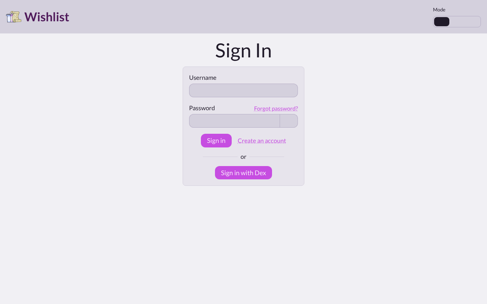

**Admin settings are the whole policy.** Suggestions on/off + method; claims: show name, show
name across groups, show name publicly, **show for list owner** (global!), require e-mail for
anonymous claims; lists: default list creation, **allow public lists** (off by default, so an
owner can't share publicly until the admin flips it); default group; SMTP; signup; password
strength; disable password login; OIDC. 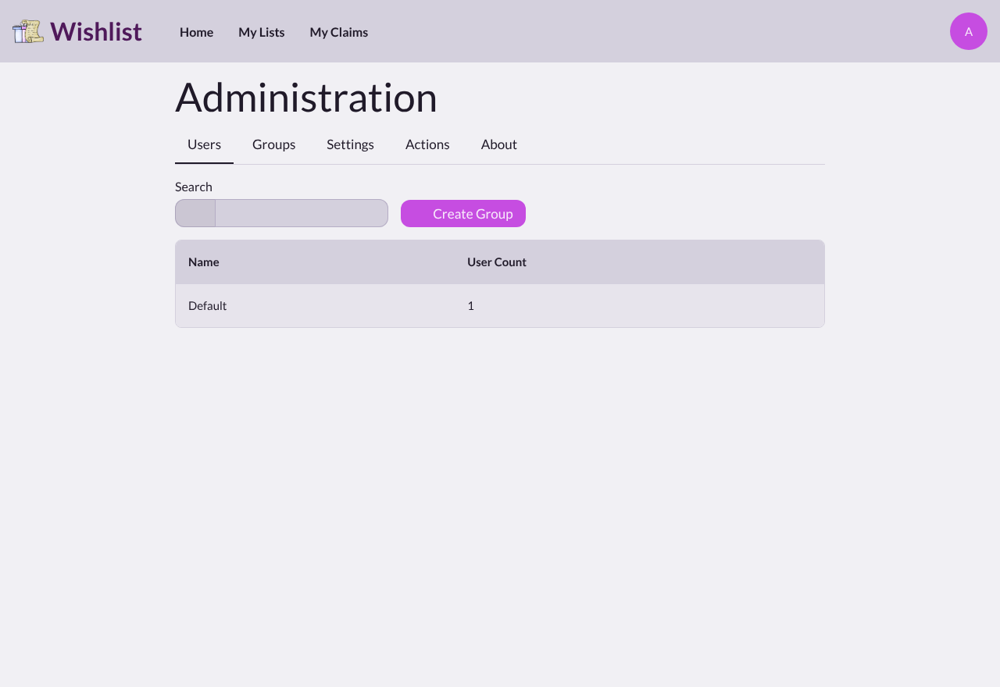

**Owner.** A list is auto-created ("Alice's Wishes"). Manage: name, icon, colour, Public, Hide
owner, "This list is for someone else", "Allow owner to claim items" (greyed unless the group
setting lets owners see claims), Markdown description, list managers. Add item: URL (fetch →
500 here, non-blocking), name, price + currency, quantity or "No limit", image upload/URL,
"Most wanted", Markdown notes, multi-list, plus an import page. "Share List" flips the list
public and copies the link, which is the *same* `/lists/<id>` URL as the private one. The header
counts quantities: "5 items · $242.99" for three items. 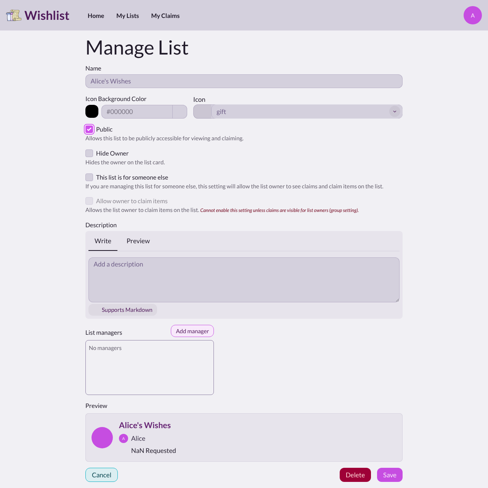

**Givers.** Claim is one click for qty-1 items, a quantity dialog otherwise; the card shows
"1 desired · 1 claimed" and the button becomes Unclaim / "Update claim". Carol sees "Claimed by
Bob" (default `claimsShowName=true`) and no button → no double gift; after Bob unclaims she can
claim. A separate "My Claims" page has Unclaim and "Mark item as purchased", i.e. a two-state
claimed/purchased model. 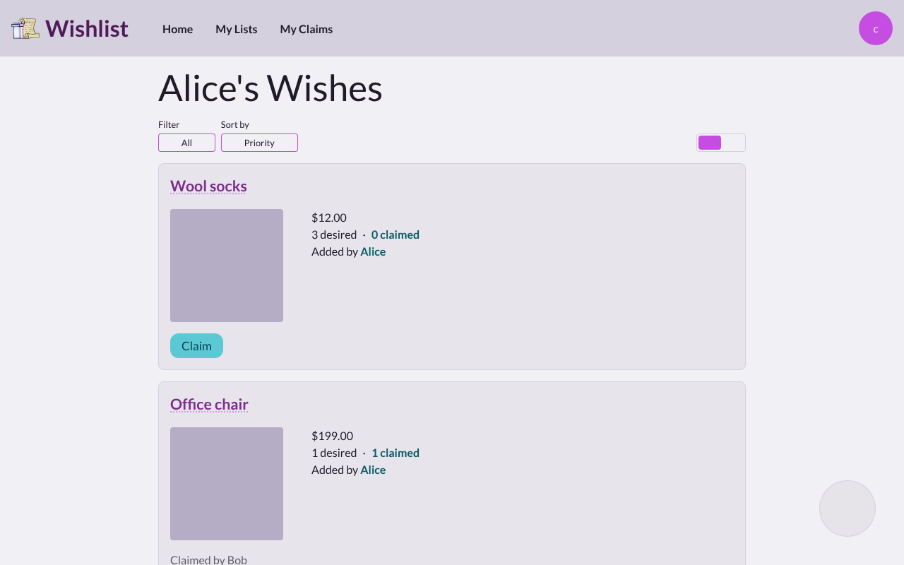 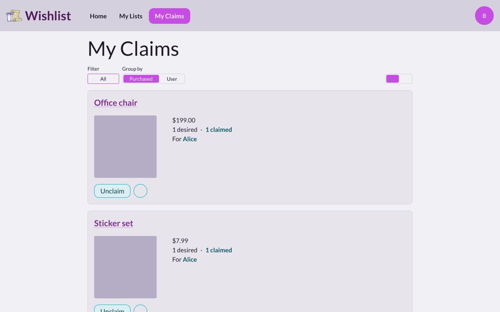

**Owner view after claims.** Alice still sees "1 desired" and nothing else; correct, but the
knob that controls it is the admin's global "Show for list owner". 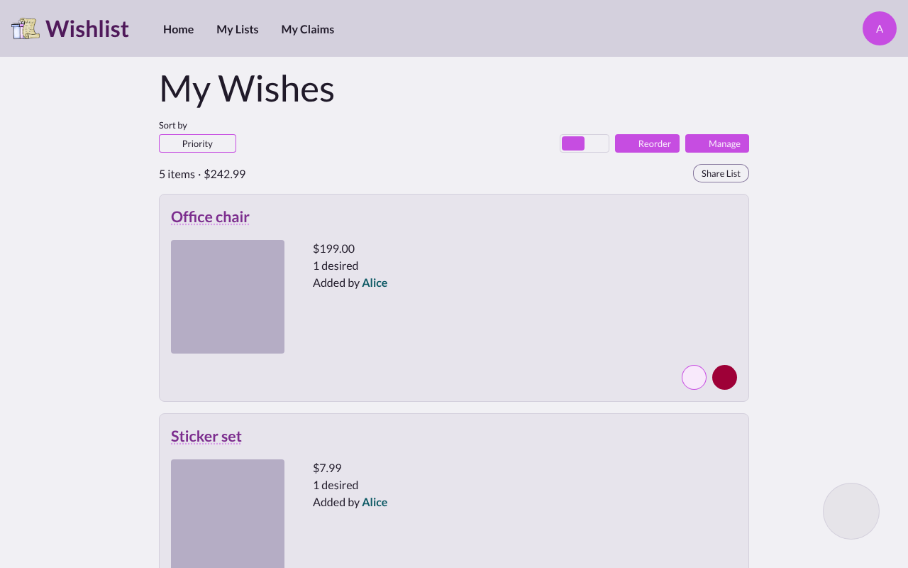

**Anonymous.** Can view the public list and claim after entering an e-mail (name optional).
After claiming, the item just says "Claimed" with no Unclaim, even in the same browser session:
anonymous claims are irreversible. 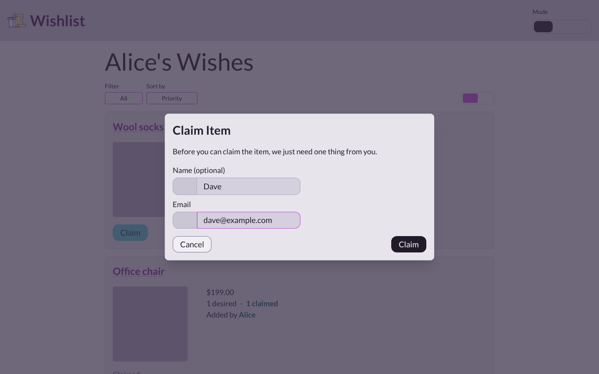 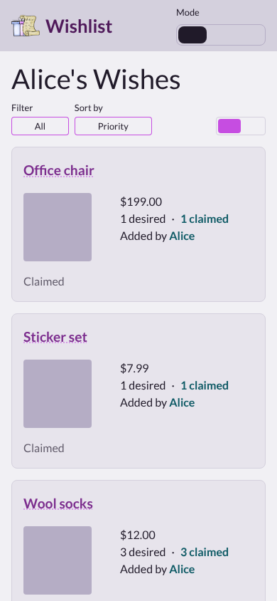

**Peculiarities.** Icons come from `code.iconify.design` at runtime (blank squares offline);
`/admin/sw.js` 404 is logged on every admin page; the only third-party script is the icon CDN;
no analytics, no referral parameters.

*Suggested "Excluded" bullets:* owner visibility of claims is a single global admin switch;
public lists need admin permission; anonymous claims can't be undone; new sign-ups hit an error
page until the admin configures a default group; lots of surface (groups, suggestions, managers,
most-wanted, claimed vs purchased, 19 languages).

## Christmas Community

`wingysam/christmas-community:latest` (v1.42.0). Repo: 413 commits, 7 in the last 12 months
(latest tag 2025-12-31), 34 authors.

**First run.** The first boot logs a LevelDB `OpenError … /data/dbs/users/LOCK` crash before
the supervisor restarts the app. `/setup` asks for an admin username and password and then
logs you *out*. There is no self-registration: the admin types a username in Admin Settings and
gets a `/confirm-account/<token>` link (7 days) to pass on by hand; the user sets a password
there. Admin can also impersonate ("Log in as alice"), promote, rename, reset, delete.
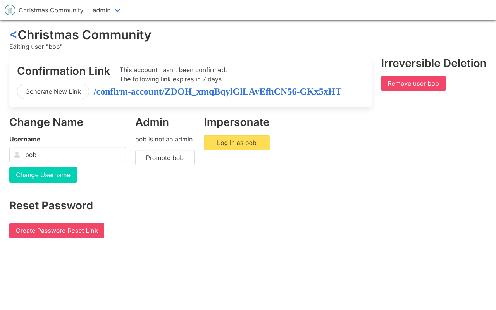

**Auth.** Password, Google SSO env vars, or any OIDC provider via env vars (HTTP issuer
accepted; auto-create worked); "Link Dex account" on the profile. 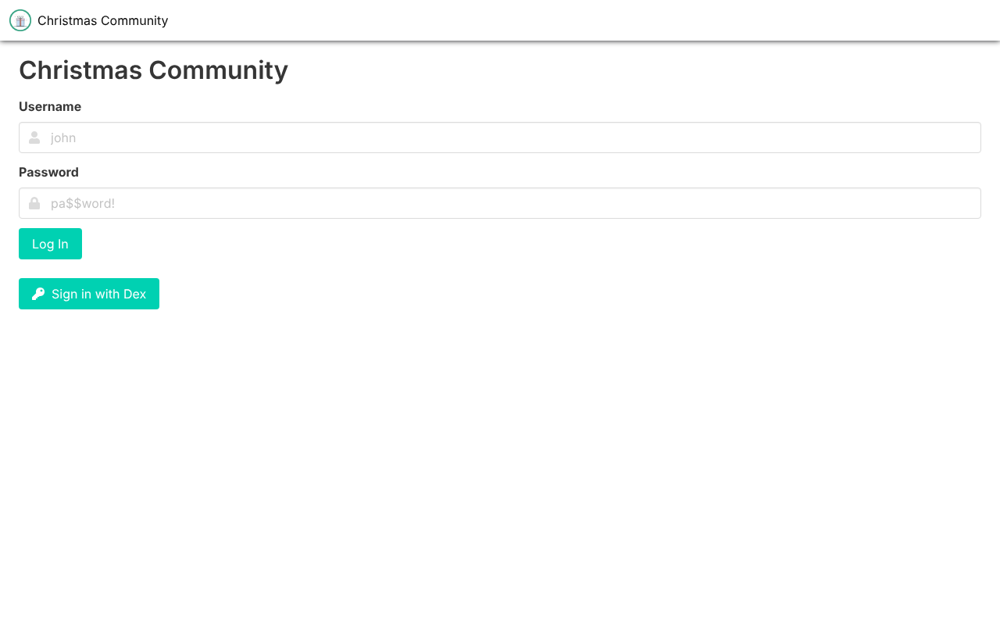

**Model.** One list per user at `/wishlist/<username>`. The profile page collects shoe, ring,
dress, sweater, shirt, pants, coat and hat sizes plus phone model. Add item = a single "Item
URL or Name" field + note; scraping (get-product-data v1.19) failed offline and the URL became
the name. Owners can only reorder, edit, delete: no price, quantity or image of their own.
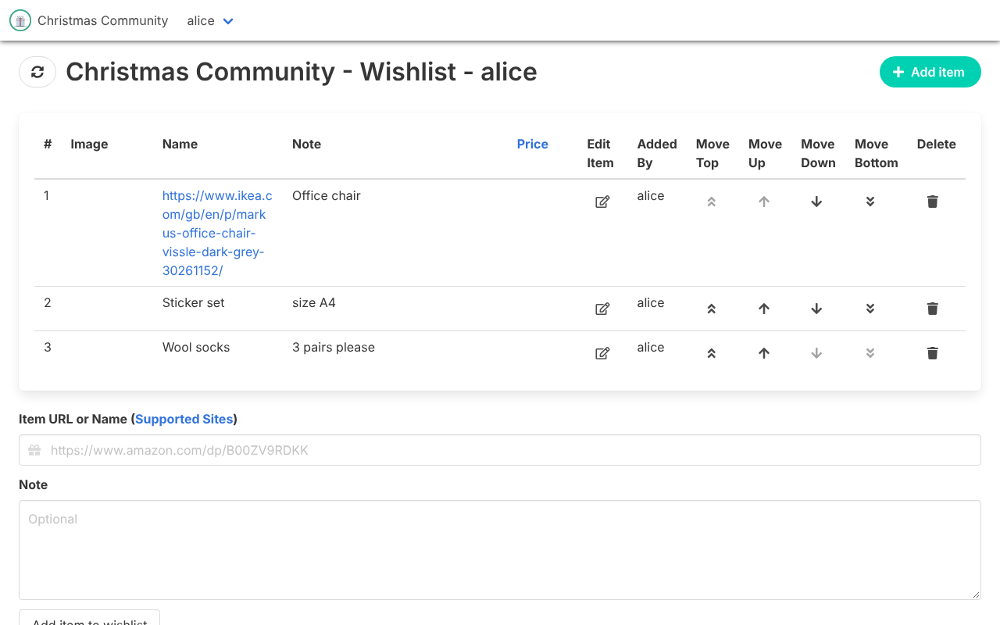

**Givers.** "Pledge item" / "Unpledge" are one click with a flash message. Carol sees "Pledged
for by bob" and no button; after unpledge she can pledge. No purchased state. Other members may
also add items to Alice's list: "Suggest item" (visible) or "Pledge item" which creates a hidden
item already pledged by them (Carol's attempt yielded "Pledged item for alice." and item #4
hidden from Alice). 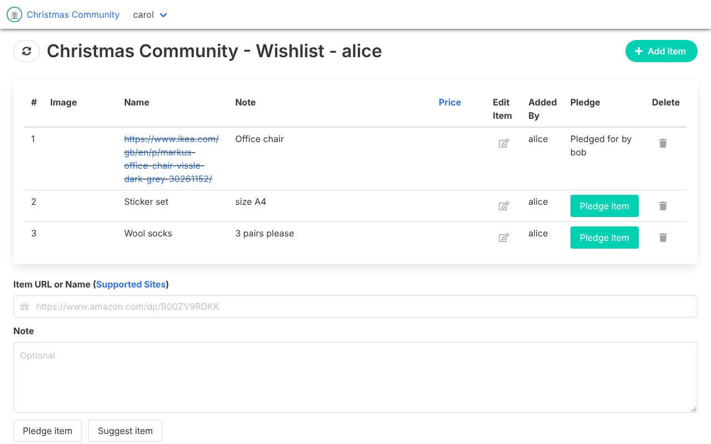

**Owner view.** Alice never sees pledges and the home page shows her own counters as
"???/???". No toggle exists.

**Anonymous.** With `LISTS_PUBLIC=true` anyone can open `/wishlist/alice` and *also sees*
"Pledged for by bob"; clicking Pledge redirects to login. `GUEST_PASSWORD` enables a guest mode
(not tested). 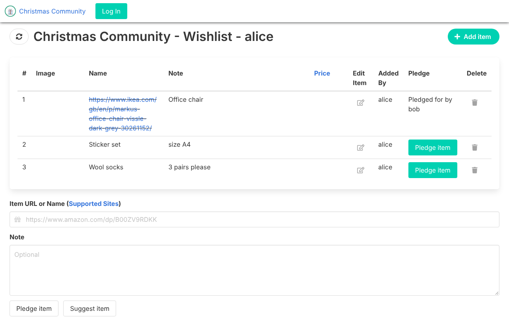 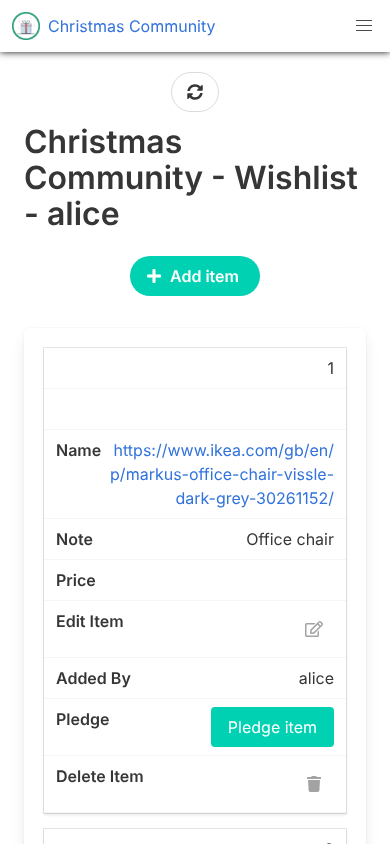

**Peculiarities.** Non-owners see Edit and Delete icons on every row that are disabled buttons
(the "buttons that don't do anything"). Table mode with a literal
"Christmas Community - Wishlist - alice" heading; snowman avatars; `UPDATE_CHECK=true` calls
GitHub by default. No external scripts, no analytics, no referral parameters.

## wishthis

`hiob/wishthis:stable` (wishthis 1.2.3) + MariaDB. Repo: 1837 commits, **0 in the last 12
months**, last commit 2025-10-14, last tag 2025-03-10.

**First run.** A web installer (DB credentials → prerequisites → install). In this sandbox the
installer and the home page pop an "Error"/"Unexpected output" modal on every load because the
home page fetches `blog.wishthis.online` at runtime; I finished the install with curl.
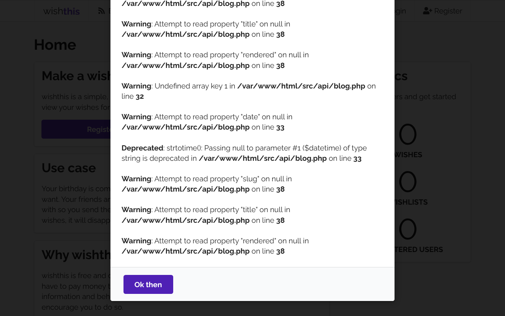

**Auth.** Open registration with e-mail, password and a "name a planet" captcha. No OIDC. The
first user is admin; the Settings page holds only MJML e-mail API keys and the menu gets a
"Login as" impersonation entry.

**Owner.** Several lists per user ("My hopes and dreams" by default). Add a wish: title,
description, URL (auto-fill → "Could not resolve host" modal here, wish still saved), priority,
image URL, "Is purchasable" + price. 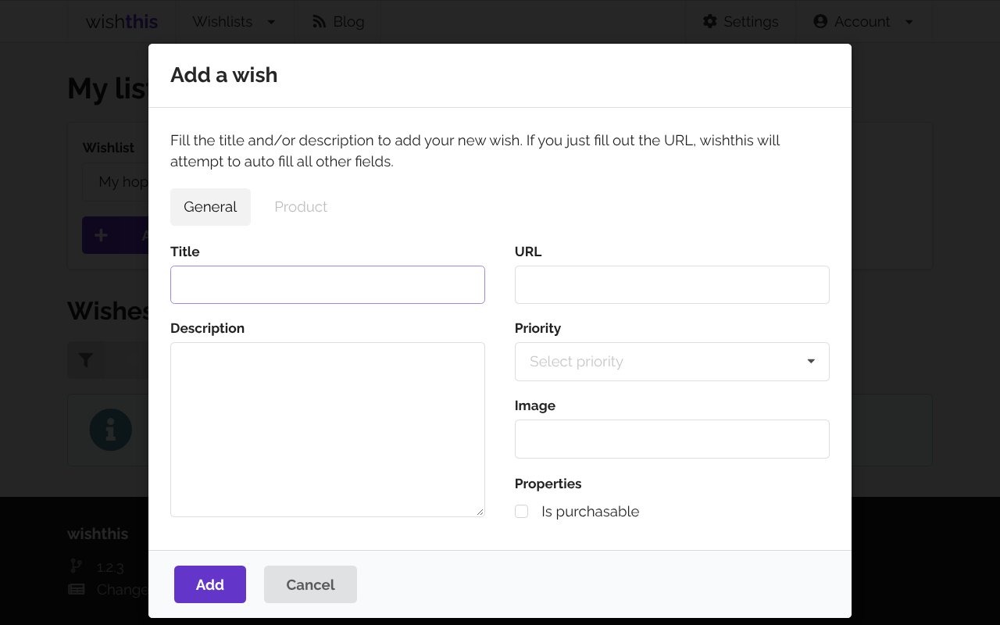

**Affiliate links, confirmed.** The wish URL `https://www.amazon.de/dp/B087H4HZQ7` is rendered
to owner, givers and anonymous visitors as
`https://www.amazon.de/dp/B087H4HZQ7?tag=grandel0b-21`.

**Givers.** Share link `/wishlist/<sha1>`, no login needed to view or fulfil. Details → "Fulfil
wish" makes the wish disappear for every other giver. There is no undo for the giver, no
claimed-vs-purchased state and nothing tells who fulfilled it. Logged-in givers can "Remember
list" and "Request more wishes". 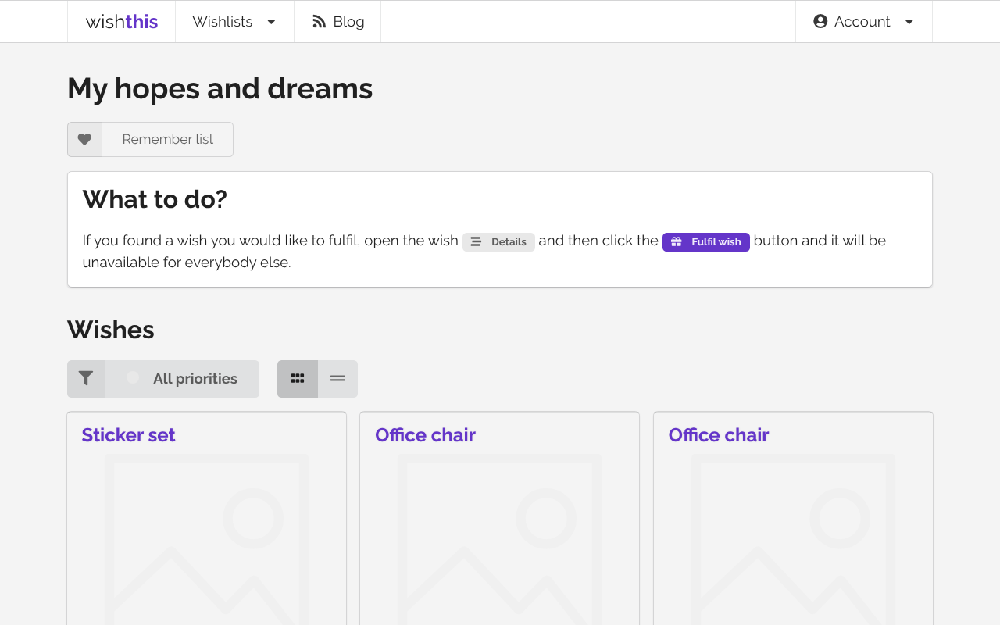 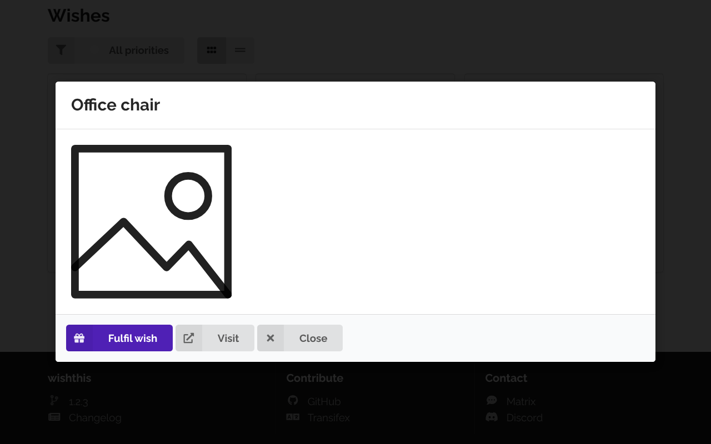

**Owner view.** Alice still sees the fulfilled wish unchanged and has her own "Mark as
fulfilled"; no toggle. 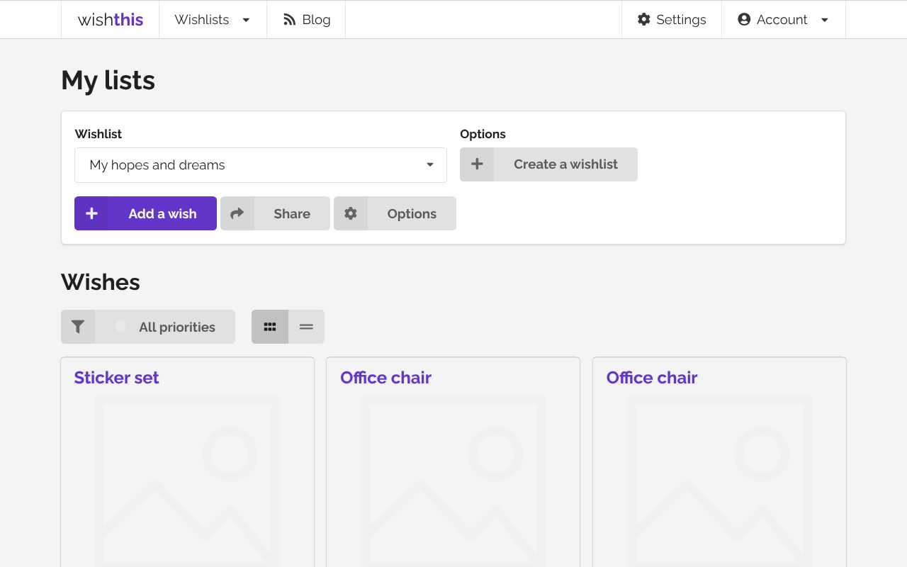

**Peculiarities.** Source references plausible.io and `pagead2.googlesyndication.com` (not
loaded on the pages I visited); 99 locales; Fomantic-UI/jQuery; failed scrapes produce modals
that keep coming back.

## Pønskelisten

`ghcr.io/aunefyren/poenskelisten:latest` (v2.4.0, 2026-09-23). Repo: 279 commits, 45 in the
last 12 months, 6 authors.

**First run.** `generateinvite=true` prints a 16-character invite code in the container log.
Registration asks e-mail, first and last name, password ×2, invite code and an "at least
thirteen years of age" consent. The form stayed on "Registering…" although the account was
created (the follow-up internal `/oauth/token` call returned 400); registering Bob through the
form hit a 500 ("Failed to get user by e-mail") while the same payload via the API returned
201. The web UI logs in through its own OAuth2/PKCE flow against the app itself.
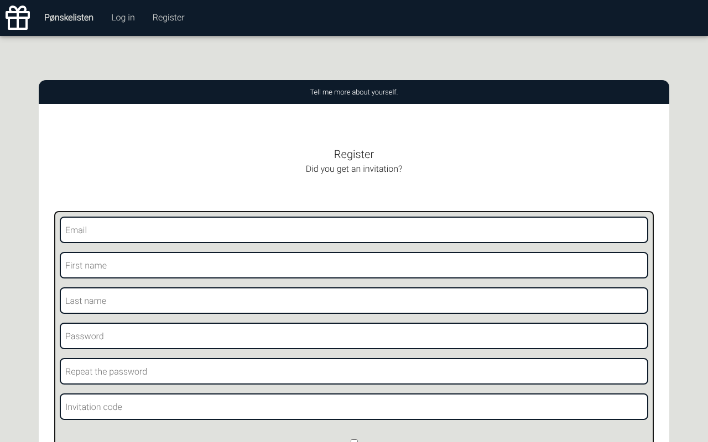

**Auth.** Password + optional OIDC via env (`oidcenabled`, issuer, client, auto-create,
`disablelocallogin`); plain-HTTP issuer accepted; "Log in with Dex" auto-created Carol.
Pønskelisten is also an OIDC *provider* for other apps, has TOTP MFA with recovery codes, a
"require MFA" policy, session management and an MCP/AI-assistant section in the admin page.

**Owner.** Wizards everywhere: list = name/description → expiry (on by default, tomorrow) →
"Allow users to claim wishes" / "Hide claimers from other claimers" / "Make this wishlist public
and shareable" → groups. Wish = name → note, URL, price, category → image. No quantity, no
scraping. 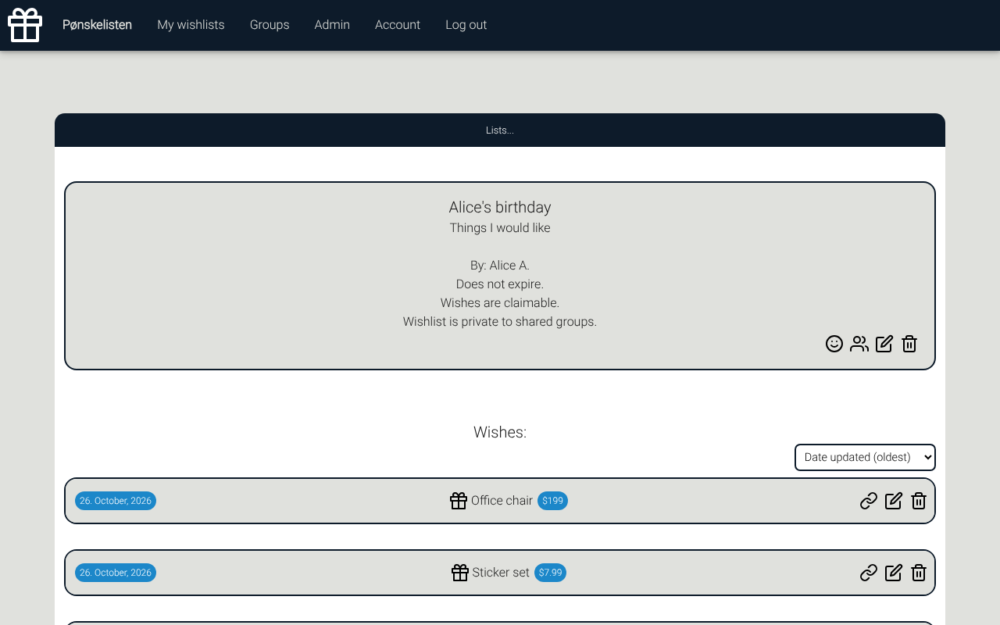

**Public vs. claimable.** The API rejects the combination outright: *"A wishlist cannot have
claimable wishes and be public to users without accounts."* So a public link is read-only, and
claiming requires an account **and** membership of a group the list was added to (owner creates
a group, picks registered users from a datalist, then adds the list to the group).

**Givers.** "Claim this gift" icon → browser `confirm()` → "Wish claimed." Carol's icon tooltip
says "Wish is claimed by Bob B." (hidden if the per-list option is on) and does nothing; after
Bob unclaims (another `confirm()`) she can claim. Single state.
 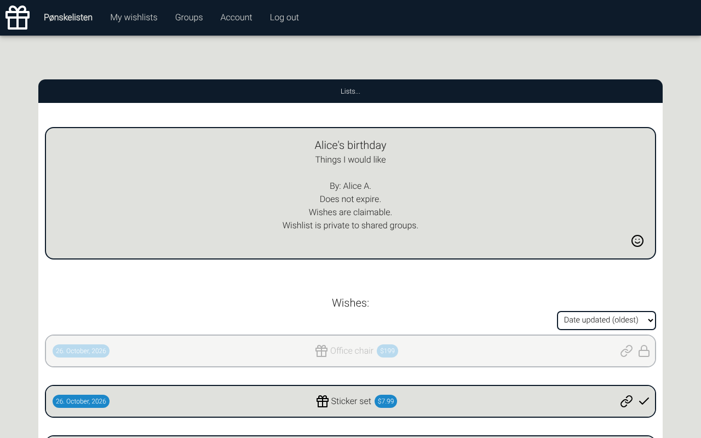

**Owner view.** No claims visible, no owner toggle (the per-list switch hides claimers from
*other claimers*). Anonymous visitors to a list URL are redirected to login.
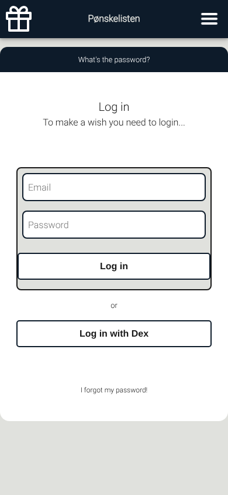

**Peculiarities.** Icon-only actions with `title` tooltips, multi-step modals, news posts on
the front page, wishlist collaborators, categories, currency padding settings. No external
scripts, no analytics, no referral parameters; external links open through a confirmation modal.

## Wishlist by Reggio-Digital

`reggiodigital/wishlist:latest` (Next.js 16.1.1). Repo: 6 commits total (2025-12-01 →
2026-01-23), 2 authors.

**Model.** One admin (`ADMIN_USERNAME/PASSWORD`), no other accounts. Ships with three demo
lists (Dad/Mom/Child, 15 US-retailer items with several store links each) that you delete
yourself. Lists are public at `/<slug>`; optional site-wide password lock; dark mode.
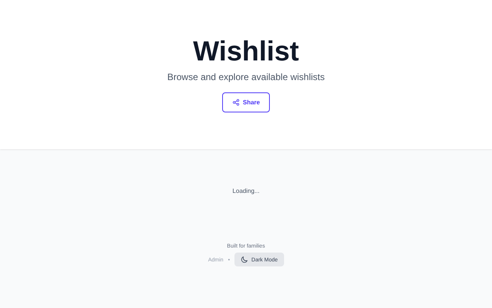 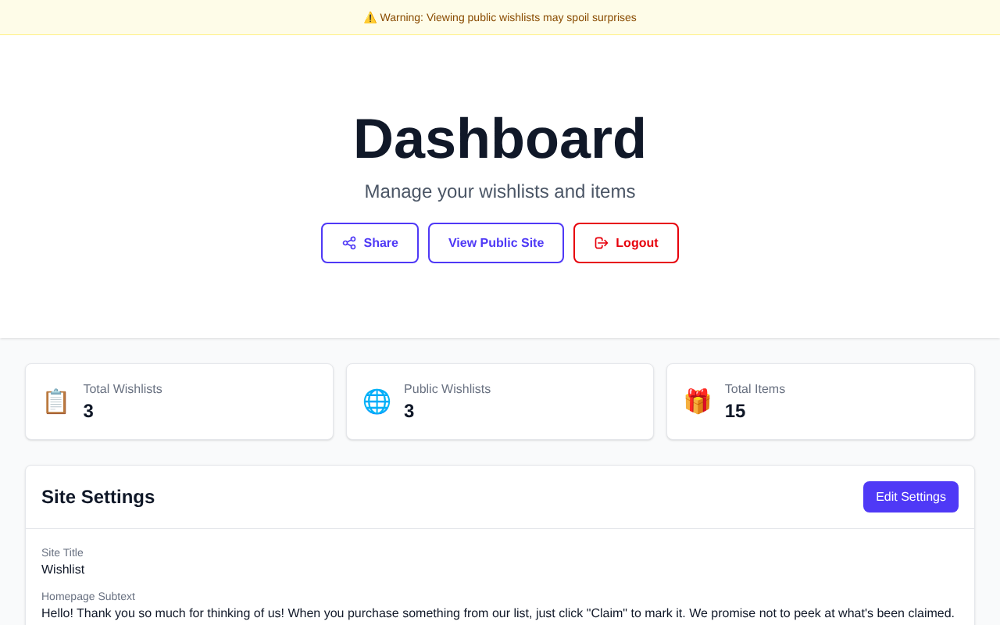

**Admin.** Create Wishlist (name, slug, rich-text description, cover image, Public), Add Item
(name, price, description, image, multiple store URLs). No scraping, no quantity. The admin item
view does not show claims; the dashboard instead warns "⚠️ Viewing public wishlists may spoil
surprises".

**Givers.** "Claim This Item" → optional note → "Confirm Claim" → "Item Claimed! The status is
now locked." Claimed items are hidden from other visitors by default ("4 of 5 items", toggle
"Show claimed items"); with the toggle on, **any** visitor sees "Claimed by  Note: …" and an
"Unclaim Item" button, so anyone can release anyone's claim and no name is recorded.
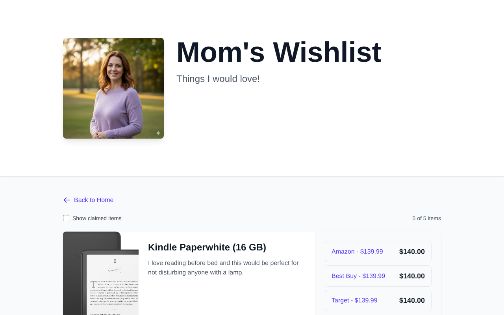 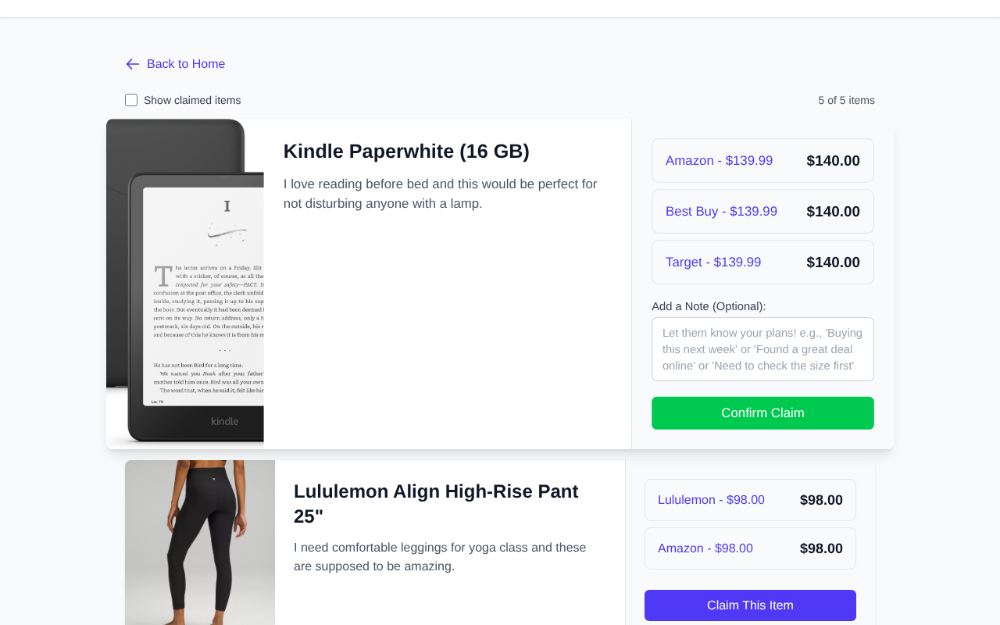 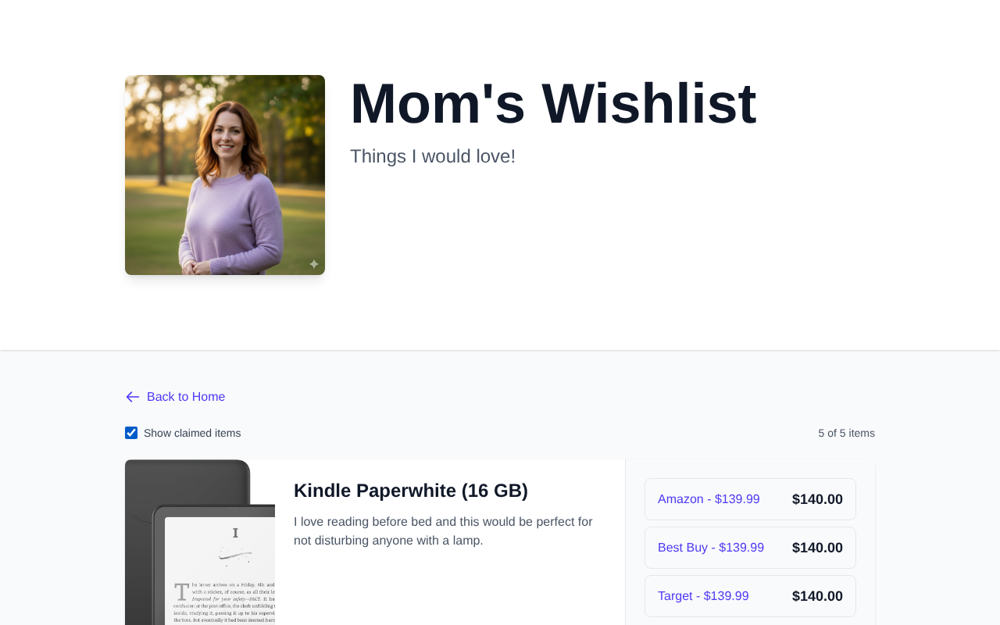
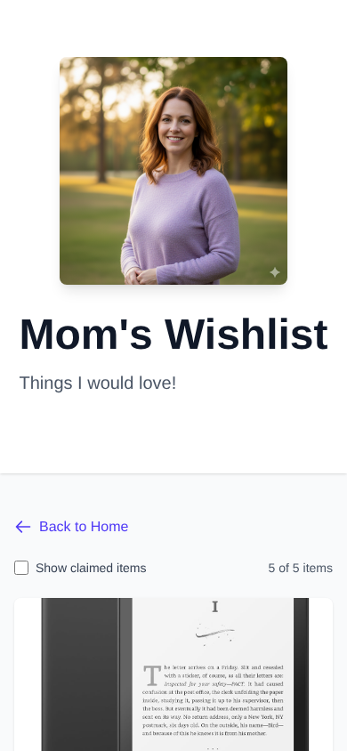

**Verdict for the post.** Clean and genuinely simple, but it is a one-household, one-admin tool:
every family member's list is created by the admin, and the admin can look at claims any time.
No external scripts, no referral parameters.

## simple-wishlist (ajb3932)

`ajb3932/simple-wishlist:latest` + MongoDB. Repo: 34 commits, 0 in the last 12 months (last
2025-07-10).

One list per instance (`LIST_NAME`, `LIST_TYPE` = bday/xmas/wedding logo, `CURRENCY`). `/setup`
creates the admin; `/admin` adds items with name, price, URL and image URL only.
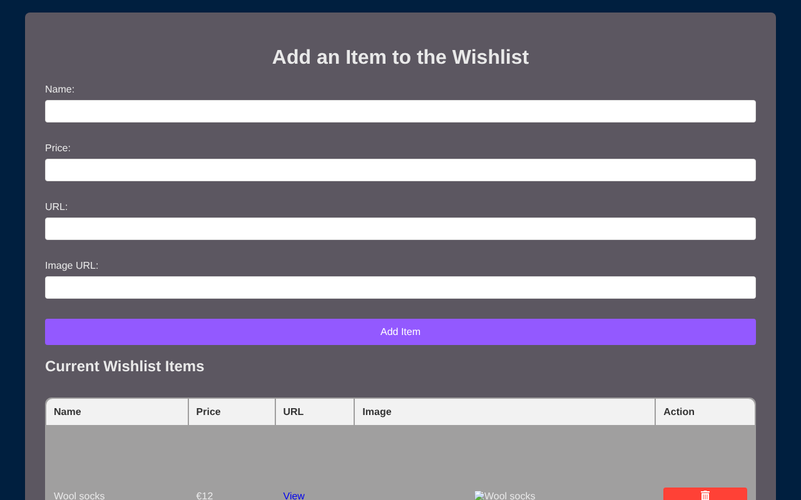

The public table has a "Purchased" button per row; the row moves to a "Purchased Items" table
with a **Restore** button that every visitor sees, so anyone can un-purchase. No names, notes
or confirmation. The admin page doesn't show purchases, but the admin is the owner and the
public page is one click away. No external scripts loaded, links untouched.
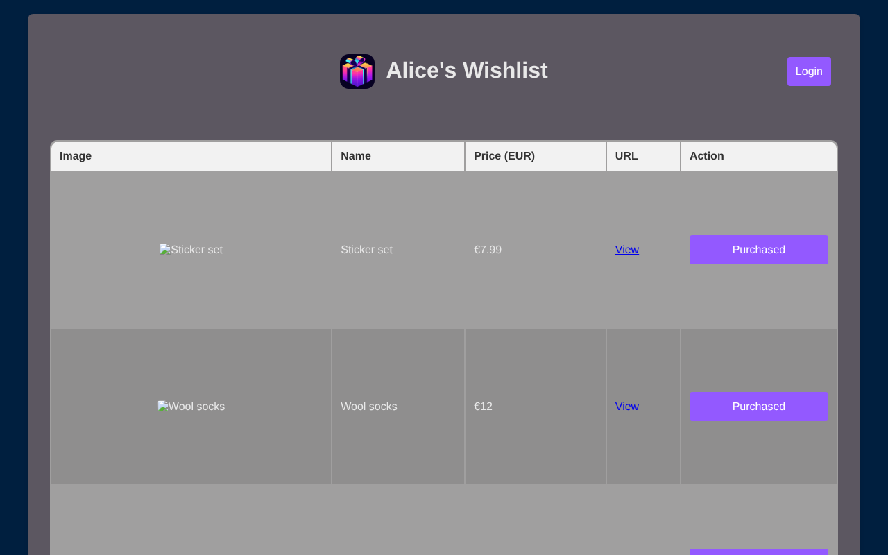 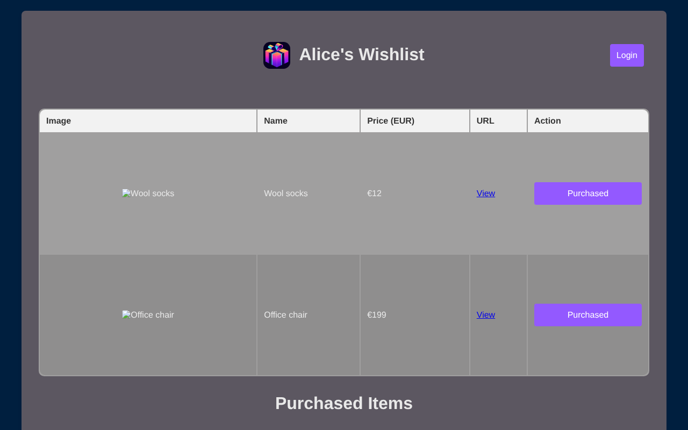

## Wilik

`ghcr.io/joostvanopdorp/wilik-{backend,frontend}:latest` (commit b570654, 2026-10-23). Repo:
108 commits since 2026-07-25, 4 authors.

**First run.** The backend log prints a one-time `/setup/<token>` link for the pre-created
Admin. Admin panel: add users by username → one-time setup link to pass on; gift directory on
the login page; **"Allow wishlist owners to opt into revealing and resetting claims on their own
list"**; app name; default theme. No self-registration, no OIDC.

**Owner.** One list per user. New item: URL + "Fetch details" (silently empty offline), image
URL, label, brand, title, product options, description, price, currency, quantity (number or
unlimited), rating. Settings: share link `/list/<8 chars>` with regenerate, directory listing,
currency/decimal formats, theme colour, placeholder images, background pattern, guest
sort/filter toggles, and (if the admin allowed it) "CLAIM MANAGEMENT — Caution! … Let me reveal
and manage claims on this wishlist", which adds a per-item "Manage claims" button.
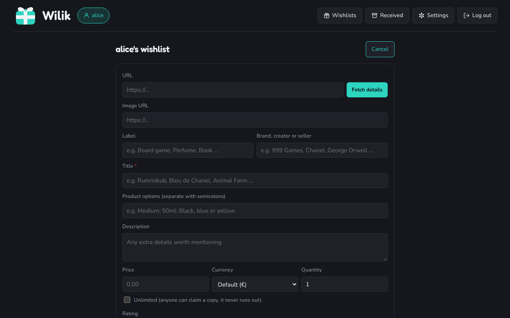 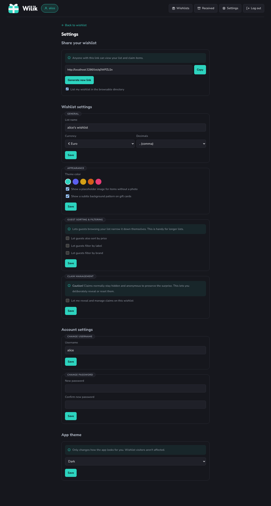 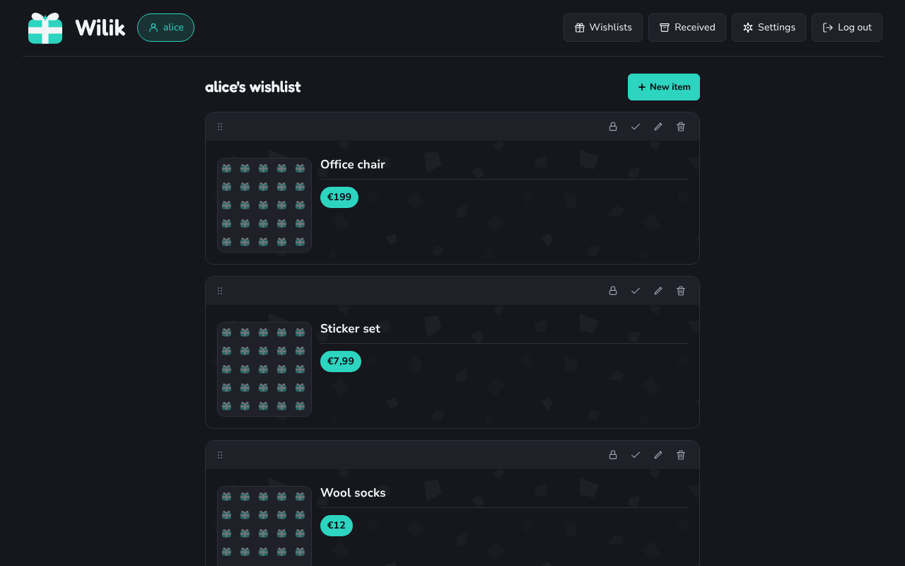

**Givers.** "Get this gift" → browser `prompt()` for a name → "Release this gift" (a claim
token stays in localStorage). Other guests see "Gift claimed" without a name and can't claim;
quantity items show "Also get this gift (1 of 3 claimed)" and an "Already claimed this? Manage
your claim" link. Releasing from another browser means re-typing the same name ("That name
doesn't match this claim" otherwise). Each click claims one unit; you can't claim two socks at
once. 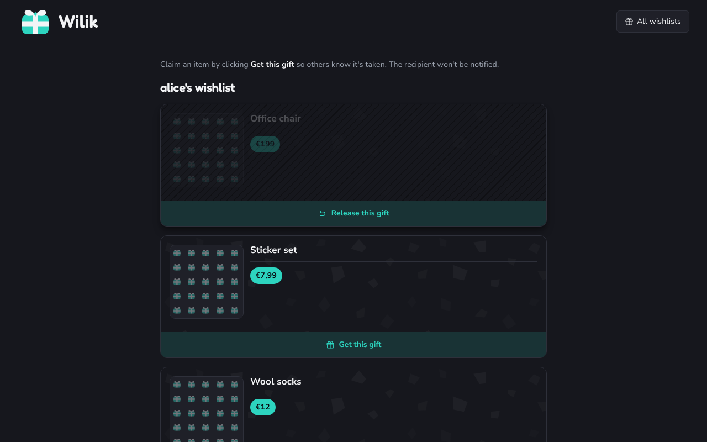 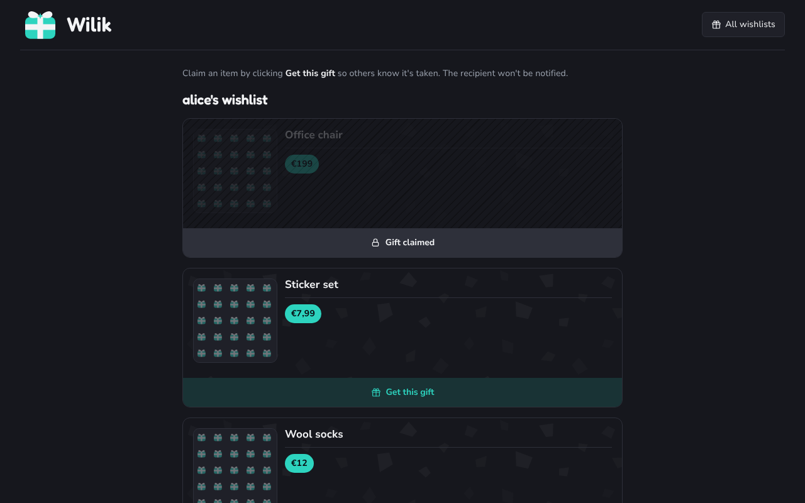 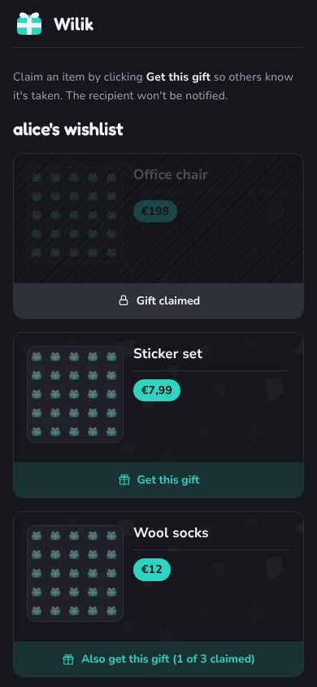

**Owner view.** Hidden by default (confirmed); revealing is owner-controlled but admin-gated,
the closest match to "the owner decides" in this set.

**Peculiarities.** Self-contained React build, no CDN, no analytics, no referral parameters;
a lot of knobs (labels, brands, ratings, currency formats, theme presets, guest filters) for a
three-month-old project.

## wysh

Desk review only. Haxe server + client, no Dockerfile, no releases, README "TODO:
documentation ;)". 112 commits between 2017-05-13 and 2017-10-30 by one author. Sign-in is
Google/Facebook only; the README's own checklist leaves "Respect privacy settings when trying
to access lists" unchecked.

## Super-Simple-Wishlist

`ghomashudson/supersimplewishlist:latest`. Repo: 33 commits, last 2024-06-15.

The published image does not start: `ImportError: lxml.html.clean module is now a separate
project lxml_html_clean`. After rebuilding it with that package, the directory page works, but
a list page scrapes every URL on first view and returns Flask's "Internal Server Error" when a
shop is unreachable, so nothing beyond the directory could be exercised. By design anyone with
the URL marks items "Bought" (`db.json`), `?exclude_purchased=1` hides them, and the owner uses
the same page. 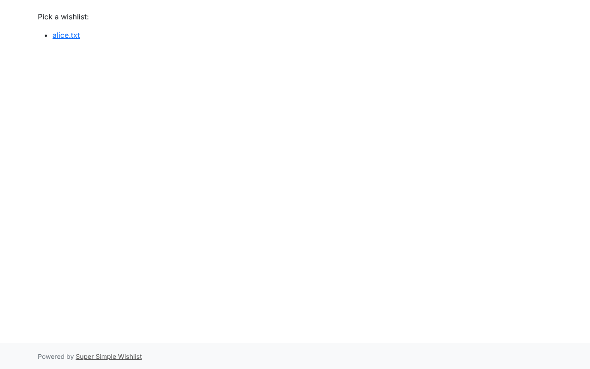 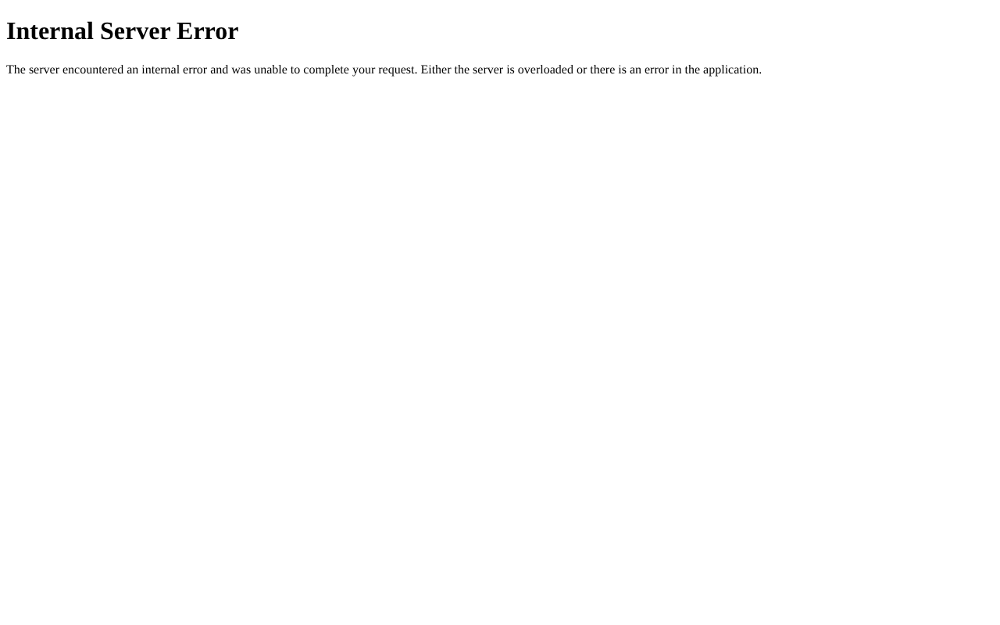

## wishlist-app (Superior-Kqller)

`ghcr.io/superior-kqller/wishlist-app:latest` (v2.1.0) + PostgreSQL. Repo: 440 commits since
2026-03-17 by one author, tag v2.1.0 on 2026-10-22, last commit on the day of the test.

**Setup.** `.env` with secrets and two seed users; compose binds to 127.0.0.1 and wants an
external `proxy` network; `NEXTAUTH_URL` must match the host you open exactly or the login
form never hydrates. Default language Russian (EN available under "Ещё → Язык"), Russian public
holidays pre-loaded in the calendar, RUB default, Ozon/Wildberries/AliExpress scraping hints.
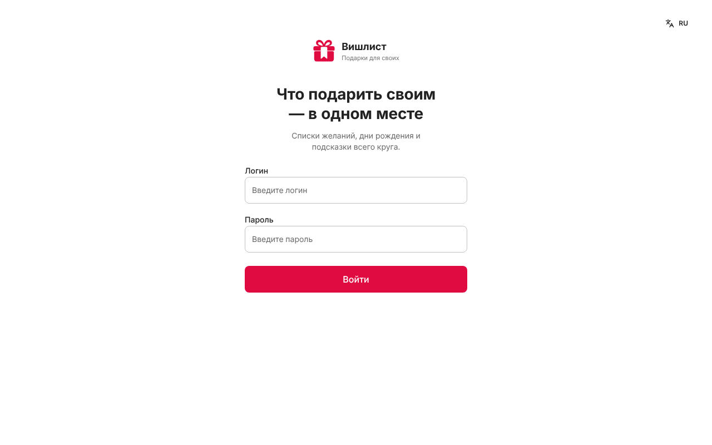 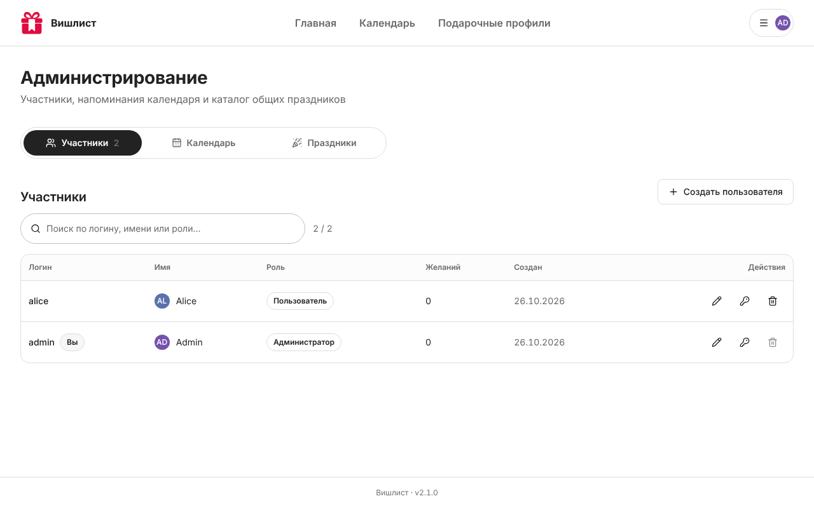

**Model.** Admin creates users; no self-registration, no OIDC. Users have "подборки"
(collections) visible only to the people the owner ticks. The picker only lists users already
in your "circle" (people you share with or who share with you), so a fresh user, and even the
admin, sees nobody to tick: the first share can't be made in the UI (I had to `PATCH
/api/lists/<id>` with viewer ids). 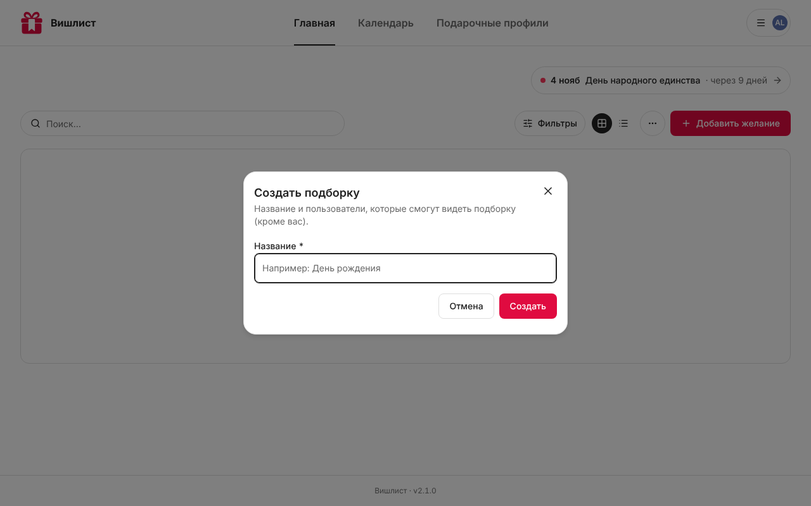
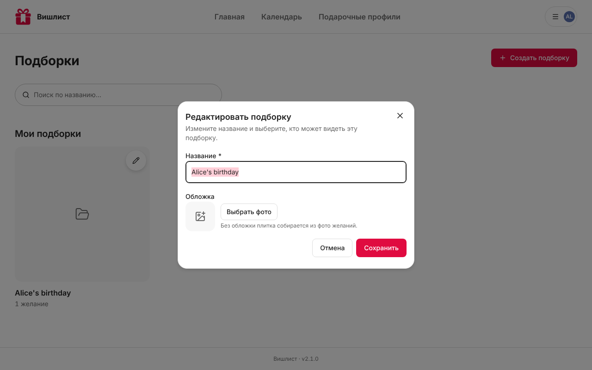

**Features.** Wishes by link or manually (title, URL, collection, category, notes, image,
price + currency, five priority levels from "Хочу при случае" to "Нужно вчера"), card/table
views, filters, comments, statistics, gift profiles (sizes, colours, brands, dislikes),
birthdays and reminders, Telegram notifications, bookmarklet, CSV/JSON export, PWA.
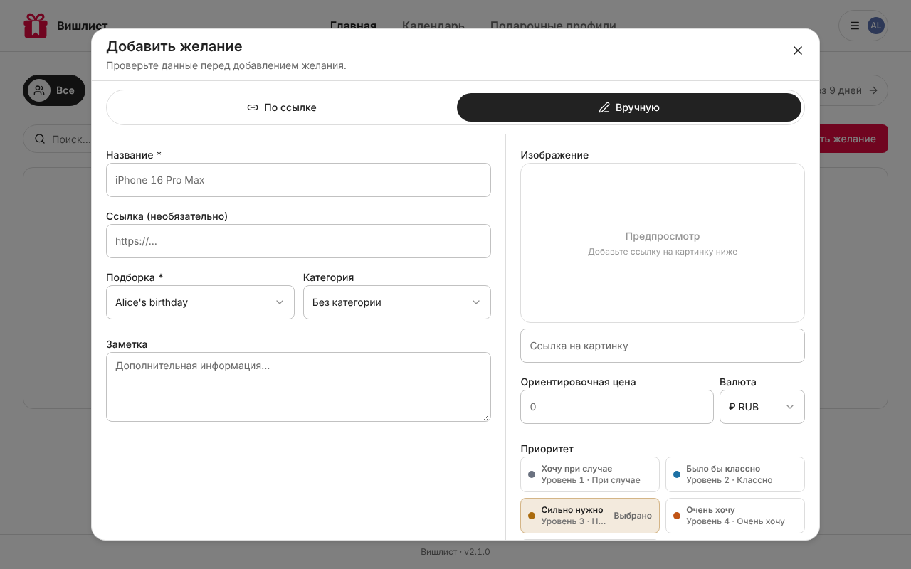

**Reservation: none for givers.** Only the owner (or an admin) gets "Отметить купленным";
Bob and Carol see "Ещё не куплено", the link and comments. In code:
`canManage = currentUserId === item.userId || currentUserRole === "ADMIN"`. The owner marks
their own items as bought. 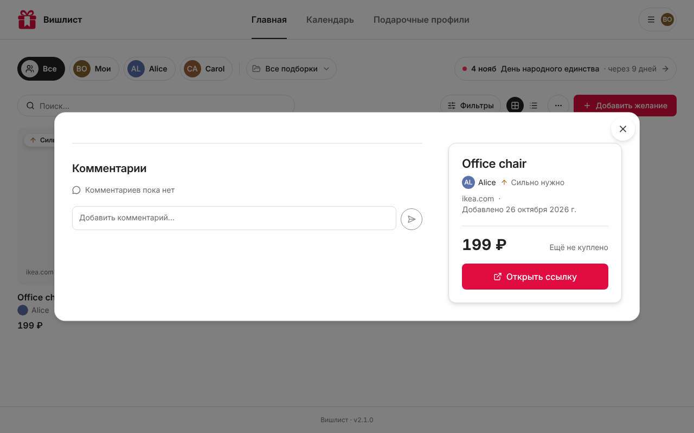 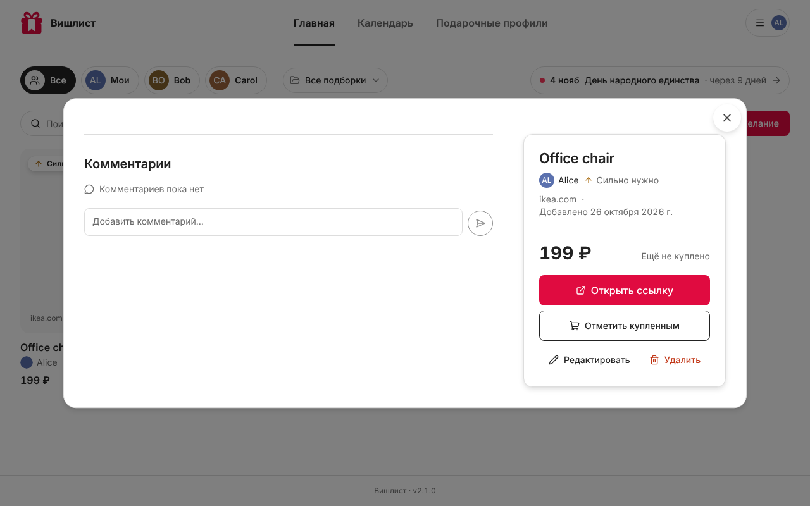
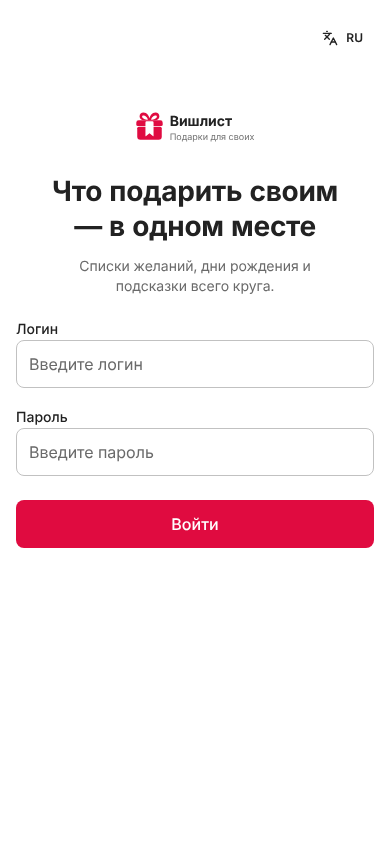

## SantiagoVargasVe/wishlist

Desk review only. The README still says "Status: Scaffold. No application code yet", but HEAD
(2026-09-23) has 240 TypeScript files, an `infra/Dockerfile`, dev/prod compose files, systemd
deploy units, a numbered task backlog, ADRs and a `CLAUDE.md` "Agent Context": a one-month,
AI-agent-driven personal project (106 commits 2026-08-23 → 2026-09-23, 3 authors incl. bots,
0 stars, no image or release). Design per its docs: paste a link → Open Graph card, share by
unguessable slug, anyone with the link can mark bought; registration by invite code only.

## Things I didn't expect

- **Nobody lets the owner decide.** The closest is Wilik: the owner may opt in to see claims,
  but only after the admin allows owners to opt in. cmintey has the switch, global and admin-only.
  Everyone else hard-codes blindness (good) or has no owner concept at all.
- **"Release" is where apps fall apart.** wishthis has no undo; cmintey's anonymous claims can't
  be undone; Reggio and simple-wishlist let *anyone* undo *anyone's* claim; Wilik ties it to a
  typed name; Pønskelisten and Christmas Community get it right but require accounts.
- **Public and claimable rarely coexist.** Pønskelisten forbids it; Christmas Community makes
  public lists read-only; cmintey needs an admin switch; wishlist-app has no public lists at all.
  Only wishthis, Reggio, simple-wishlist and Wilik let an account-less visitor reserve.
- **OIDC exists in three apps** (cmintey, Christmas Community, Pønskelisten). cmintey insists
  on HTTPS issuers. Pønskelisten is itself an identity provider.
- **Scraping is load-bearing more often than it should be.** Super-Simple-Wishlist cannot render
  at all without it, Christmas Community turns the URL into the item name, wishthis pops error
  modals; cmintey, Wilik and wishlist-app degrade gracefully.
- **Onboarding costs the giver more than a link** everywhere except wishthis, Reggio,
  simple-wishlist, Super-Simple-Wishlist and Wilik. Christmas Community and Wilik need an admin
  to mint per-user links; Pønskelisten needs an invite code *and* group membership; cmintey
  needs an admin to set a default group; wishlist-app needs an admin to create the account and
  then can't share with new users from the UI.
- **Dead or stale projects:** wishthis (no commits in 12 months, affiliate tag confirmed live),
  simple-wishlist (none in 12 months), Super-Simple-Wishlist (image won't start), wysh (2017),
  SantiagoVargasVe (README contradicts the repo).
- **Visible claimer names leak by default** in cmintey ("Claimed by Bob"), Christmas Community
  (even to anonymous visitors with LISTS_PUBLIC) and Pønskelisten (tooltip "claimed by Bob B.",
  per-list opt-out). Wilik and Reggio hide names (Reggio because it never records one).
- Small things: cmintey's wizard animation can't be skipped and its header counts quantities as
  items; Christmas Community shows disabled Edit/Delete buttons to everyone and collects
  clothing sizes; wishthis's home page calls the project blog on every load; wishlist-app's
  calendar pre-loads Russian state holidays; Reggio ships three fake family lists.

## Method and limits

- Images pulled 2026-10-26; four live on ghcr.io (needed the layer host allow-listed), the rest
  on Docker Hub (hit anonymous rate limits once). Super-Simple-Wishlist needed a patched image.
- Headless Chromium (Playwright) with one browser context per persona; 1280×800 and 390×844
  screenshots, CSS scale, no device pixel doubling.
- Containers had no outbound network, so URL scraping is "n.t." throughout and any app that
  phones home (wishthis blog, Christmas Community update check) showed errors that would not
  appear on a normal host.
- OIDC was exercised with Dex (static users) over HTTP and, for cmintey, over self-signed HTTPS.
- Maintenance numbers come from `git clone --bare --filter=blob:none` of each repo the same day;
  stars are from the post.
- Not deployed: wysh (no Dockerfile, OAuth-only login), SantiagoVargasVe/wishlist (no image,
  tunnel-based deployment).
