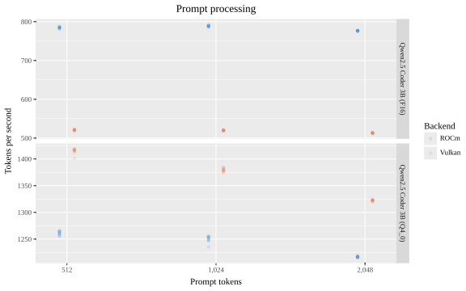
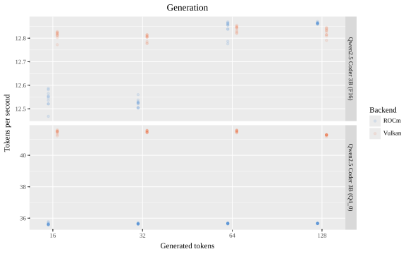

# TODO

- [ ] FIM-capable
- [ ] Vulkan vs ROCm
- [ ] FLM: making in technically possible
- [ ] FLM and AWQ: bringing performance closer to GGUF
- [ ] SAFIM comparing FLM and GGUF.
- [ ] Taskfile: sources, generates, label.


My GitHub Copilot subscription, paid for by a previous employer, has recently
ended. So before paying for it out of my own pocket, I decided to check whether
I can run a local model for inline suggestions: these do not require powerful
models, after all. And yes, of course, you can. But even running it on a GPU is
trickier than I expected, not to mention running it on an NPU.

## Fill-in-the-middle

We are mostly used to chat models that generate text left-to-right: the next
token is generated using the context that precedes it. Inline suggestions
are slightly different: both the context before and after the cursor matter.
E.g., for a docstring we need to know both the function name with arguments and
the function code.

Models used for this type of task are trained with the _fill-in-the-middle_
(FIM) objective[^1]. This is not a different model architecture, but rather a
different training objective, where given the text before and after the missing
part, the model should fill in the missing part. 

Technically, most LLMs should be able to do the task if we describe what we
expect from them in the prompt. But this is very chatty, less efficient, and
more likely to produce an output format we do not expect. For this reason, the
inline suggestion tool format their requests to LLMs in a special FIM format.
However, not all models understand it because in order to do so, the model
should have been trained on this format. So we need to narrow down the list of
models to the ones that were.

Given the aspects which I will discuss in the NPU section, I will just mention
that [Qwen2.5-Coder-3B](https://huggingface.co/Qwen/Qwen2.5-Coder-3B) is one of
these models.

## GPU

Running on GPU, regardless of whether it is discrete or integrated, is
straightforward: just find a suitable model and serve with
[llama.cpp](https://github.com/ggml-org/llama.cpp) using the backed that your
GPU supports.

### Vulkan vs ROCm

I have an integrated Radeon 890M, which supports both Vulkan and ROCm on Linux, 
so I have to pick.

**Vulkan** is a cross-vendor, low-level graphics API that also supports compute
shaders. llama.cpp's Vulkan backend expresses the same operations as generic
shaders, which the driver then compiles for whatever GPU is there.

**ROCm** is AMD's GPU compute platform, an answer to NVIDIA's CUDA. Its main
programming model is HIP, which looks like CUDA and compiles to code written
specifically for AMD GPU architectures. llama.cpp has a dedicated HIP backend
for it.

Vulkan only needs the regular graphics driver, so it is much easier to set up,
and because it is cross-vendor, it has larger adoption and is more stable. ROCm
is vendor-tuned and targets the hardware directly, so it one can expect that
matrix-multiplication should be faster on ROCm. On the flip side, support for
integrated GPUs is often unofficial, and therefore the whole setup can be less
stable and require some fiddling to make it work. For example, the 890M needs
`HSA_OVERRIDE_GFX_VERSION=11.0.0` to make ROCm treat it as an RDNA 3 GPU
(gfx1100) instead of its actual RDNA 3.5 architecture (gfx1150), for which ROCm
has no kernels.

Luckily, llama.cpp has a built-in utility for measuring model throughput, which
I used it to benchmark performance:

- across the two backends,
- for two quantization levels,
- across input and output sizes realistic for FIM tasks.





The main takeway here is that for inline completions, which typically have long
prompts and short completions, it's prompt processing that is the bottleneck,
and ROCm is noticably faster for the F16 variant, while Vulkan is faster for Q4_0.

Treat these conclusions with a grain of salt, though. I noticed that the same
parameters can yield wildly different results within the different retries of
the same experiment run. The likely culprit is thermal throttling: giving the
GPU time to cool down between runs seemed to help, and the results become much
more stable. However, I have not tested this hypothesis directly, so I cannot
guarantee that the results shown here are not affected by it, rather than being
stable because they are equally affected.

## NPU


## References and links

[^1]: Bavarian, M., et al. (2022). [Efficient training of language models to fill in the middle](https://arxiv.org/abs/2207.14255). arXiv.

<!--Saving for reference-->
<!--


```bash
#!/usr/bin/env bash
some
bash
code
```


-->
