My GitHub Copilot subscription, paid for by a previous employer, has recently
ended. So before paying for it out of my own pocket, I decided to check whether
I can run a local model for inline suggestions: these do not require powerful
models, after all.

And yes, of course, you can. But everything ended up being trickier than I
expected. Even running the model on a GPU had its quirks, not to mention running
it on an NPU.

In case you want to follow this short write-up step by step, all the scripts
used for the conversion, benchmarks and plots in this post are [on
GitLab](https://gitlab.com/nickto/fim-in-flm).

## Fill-in-the-middle

We are mostly used to chat models that generate text left-to-right: the next
token is generated using the context that precedes it. Inline suggestions are
slightly different: both the context before and after the cursor matter. E.g.,
for a docstring we need to know both the function's name along with arguments
and the function's body.

Models used for this type of task are commonly trained with the
_fill-in-the-middle_ (FIM) objective, proposed by [Bavarian, M., et al. in
2022](https://arxiv.org/abs/2207.14255). This is neither a different model
architecture, nor a different loss function, rather a different training goal,
where, given the text before and after the missing part, the model should fill
in the missing part.

It is worth noting that, technically, most LLMs should be able to do the task if
we describe what we expect from them in the prompt. But this is very chatty,
less efficient, and more likely to produce an output format we do not expect.
For this reason, inline suggestion tools format their requests to LLMs in a
special FIM format. However, not all models understand it because in order to do
so, the model should have been trained on this format. So we need to narrow down
the list of models to the ones that were.

[Qwen2.5-Coder-3B](https://huggingface.co/Qwen/Qwen2.5-Coder-3B) is one of such
models, and it is the one I use throughout this post. Why this one in particular
will become clear in the [FastFlowLM](#fastflowlm) section.

### The prompt format

Let's take a simple example. Suppose we have the following function:

```python
def add(a, b):
    c = a + b
    return c
```

where `c = a + b` is the middle part that should be filled in. We can then mark
this with special tokens, like this:

```text
<|fim_prefix|>def add(a, b):
    <|fim_middle|>c = a + b<|fim_suffix|>
    return c<|endoftext|>
```

But because the middle section is the one that we need to predict, we move it to
the end, so in the training data it looks like this:

```text
<|fim_prefix|>def add(a, b):
    <|fim_suffix|>
    return c<|fim_middle|>c = a + b<|endoftext|>
```

And during inference, this request should be formatted as the following prompt
for Qwen2.5-Coder:

```text
<|fim_prefix|>def add(a, b):
    <|fim_suffix|>
    return c<|fim_middle|>
```

So the actual JSON request to the LLM looks like this:

```json
{
  "model": "<model name>",
  "max_tokens": 64,
  "temperature": 0,
  "prompt": "<|fim_prefix|>def add(a, b):\n    <|fim_suffix|>\n    return c<|fim_middle|>"
}
```

## Baseline: llama.cpp on the GPU

Running on GPU, regardless of whether it is discrete or integrated, is
relatively straightforward: just find a suitable model and serve with
[llama.cpp](https://github.com/ggml-org/llama.cpp) using the backend that your
GPU supports.

### Vulkan or ROCm

I have an integrated Radeon 890M, which supports both Vulkan and ROCm on Linux,
so I have to pick.

- [Vulkan](https://en.wikipedia.org/wiki/Vulkan) is a cross-vendor, low-level
  graphics API that also supports general-purpose compute. Its GPU programs are
  called shaders, a name inherited from graphics, but a compute shader is just a
  function that runs in parallel across thousands of GPU threads.
- [ROCm](https://en.wikipedia.org/wiki/ROCm) is AMD's vendor-specific GPU
  compute platform: an answer to Nvidia's
  [CUDA](https://en.wikipedia.org/wiki/Cuda). Its main programming model is HIP,
  which looks like CUDA and compiles to code written specifically for AMD GPU
  architectures.

Vulkan only needs the regular graphics driver, so it is much easier to set up.
Because it runs on any GPU (be it AMD's or Nvidia's) it has larger adoption and
is more stable. ROCm is vendor-specific and targets the hardware directly. But
in return one can expect that matrix multiplication should be faster on ROCm. On
the flip side, support for integrated GPUs is often unofficial, and therefore
the whole setup can be less stable and require some fiddling to make it work.
For example, the 890M needs `HSA_OVERRIDE_GFX_VERSION=11.0.0` to make ROCm treat
it as an RDNA 3 GPU (gfx1100) instead of its actual RDNA 3.5 architecture
(gfx1150), for which ROCm has no kernels.

Which of the two is faster for our use case, we will see in the
[Speed](#speed) section.

### Smoke test

As a quick test of whether it works, let's send the `add` example from
[above](#the-prompt-format) to the F16 Qwen2.5-Coder-3B model. Assuming that
llama.cpp is running on `localhost:8080`, the full `curl` command looks like
this:

```bash
curl -s http://localhost:8080/v1/completions \
    -H "Content-Type: application/json" \
    -d '{
          "model": "qwen2.5-coder-3b-f16",
          "max_tokens": 64,
          "temperature": 0,
          "prompt": "<|fim_prefix|>def add(a, b):\n    <|fim_suffix|>\n    return c<|fim_middle|>"
        }' \
    | jq '.choices[0]'
```

The result is:

```json
{
  "text": "c = a + b\n    return c\n\ndef sub(a, b):\n    c = a - b\n    return c\n\ndef mul(a, b):\n    c = a * b\n    return c\n\ndef div(a, b):\n    c = a / b",
  "index": 0,
  "logprobs": null,
  "finish_reason": "stop"
}
```

which implies that the code after the suggested completion is:

```python
def add(a, b):
    c = a + b
    return c

def sub(a, b):
    c = a - b
    return c

def mul(a, b):
    c = a * b
    return c

def div(a, b):
    c = a / b
    return c
```

We can discuss whether this is exactly what we wanted or not, but at least it is
hard to argue that this is not a perfectly valid completion.

## Why an NPU

Another option is to run on an NPU, e.g., I have an AMD Ryzen AI 9 HX 370, which
has one built in. An NPU (neural processing unit) is an accelerator that is
basically built for efficient matrix multiplication. And neural networks mostly
consist of matrix multiplications, so it is very suitable for running them.
Unlike a GPU, its goal is energy efficiency rather than peak speed
([AMD](https://www.amd.com/en/blogs/2023/on-chip-ai-integration-is-the-future-of-pc-computi.html)
itself positions it for sustained AI workloads at low power).

How does it achieve this efficiency? It's a trade-off. A GPU is very flexible:
it decides how to schedule the work while it is running, so it can handle almost
any parallel computation. An NPU saves power by having this decided in advance,
when the model is compiled for it. The result is efficient, but only for the
exact computation it was prepared for.

The practical consequence of that is that you cannot just run any model on it,
like on a GPU. Each model has to be specifically prepared for the hardware so
the choice of the models that can run on it is very limited.

If running models on NPU is hard, why use it at all for our task? The inline
suggestions are a background task: they fire constantly while you type. So
running them on a GPU is hard to miss: its load sits close to 100% almost all of
the time. Even if a small iGPU cannot heat your whole house, it still can work as
a good hand warmer, which is nice. But it drains the battery, which is not nice.
So hopefully, by running the model on an NPU, we will lose the hand-warmer feature,
but save the battery.

## FastFlowLM

Luckily, there is a great project, called [FastFlowLM](https://fastflowlm.com/)
(FLM). It is a runtime for the Ryzen AI NPU. You install it, run something like
`flm serve llama3.2:1b`, and get a local server with an OpenAI-compatible API
that any tool can talk to.

FLM [started in 2025](https://github.com/ROCm/FastFlowLM/blob/main/flm_story.md)
as a university research project and quickly became a small startup. In July
2026, [it officially joined
AMD](https://www.amd.com/en/blogs/2026/fastflowlm-joins-amd-to-advance-ai-inference.html),
and the code now lives in [AMD's ROCm
organisation](https://github.com/ROCm/FastFlowLM).

### Models and the completions endpoint

FLM offers a pretty [wide choice of smaller
LLMs](https://fastflowlm.com/docs/models/) (and a couple of other neural
networks).

Among many others, they ship
[Qwen2.5-3B](https://fastflowlm.com/docs/models/qwen/#-model-card-qwen25-3b-instruct).
Admittedly, it is a bit boring in itself, but its existence is crucial for our
exercise. Even though it is an Instruct rather than a Coder variant---and
therefore cannot do FIM---it comes from a family of models that share the same
architecture and include a Coder variant. And we will use it to run our inline
suggestions.

The list is constantly being updated, so it's worth keeping an eye on. E.g., last
time I checked,
[Qwen3.8-27B](https://fastflowlm.com/docs/models/qwen/#-model-card-qwen38-27b)
was not there yet, but is there now.

Moreover, besides the usual `/v1/chat/completions` endpoint, which is used for
chats, FLM also supports the [legacy
`/v1/completions`](https://github.com/ROCm/FastFlowLM/releases/tag/v0.9.13)
endpoint, and this is another key piece that makes inline suggestions possible.

The difference between the two endpoints is what happens to your text. The chat
endpoint takes a list of messages, and the server wraps them in the model's chat
template before the model sees them. The completions endpoint, on the other
hand, takes a raw prompt, passes it to the model as is, and the model simply
continues it.

FIM needs the latter, because a FIM request is not a conversation. It is a
single string that contains the context before and after where we want the
suggestion.

This may sound like a minor detail, but many serverless model providers offer
only the chat endpoint, so you cannot use them for inline completions, even if
the model itself was trained for FIM. Technically, one could maybe find a
workaround, but the existing tools expect the `/v1/completions` endpoint (or an even
less commonly supported `/v1/fim/completions`).

### Closed kernels, no FIM model

But there is one important caveat: FLM is only partly open source. The
orchestration code and the CLI are
[MIT-licensed](https://github.com/ROCm/FastFlowLM/blob/main/LICENSE_RUNTIME.txt),
but **the NPU kernels are closed binaries**. They are [free for any
use](https://github.com/ROCm/FastFlowLM/blob/main/LICENSE_BINARY.txt), including
commercial, but you cannot read or change them. And these kernels are the part
that actually runs on the NPU, so if the model is not on the list, there is not
much you can do. At least without jumping through a lot of hoops.

Unfortunately, even though FLM offers quite a few models, none of them are
FIM capable. So we cannot use an off-the-shelf solution here.

## Getting the Coder onto the NPU

### Borrowing the kernels

One way of jumping through the hoops is to reuse the kernels of a model that is
already supported, and only replace the weights. However, this is possible only
if the models share the exact same architecture. This is the approach used in
[this project](https://github.com/ROCm/FLM_Q4NX_Converter).

And we are in luck here again, because the commonly recommended models for
inline completions are the smaller versions of Qwen2.5-Coder. Since, as we have
already figured out, [Qwen2.5-3B
Instruct](https://fastflowlm.com/docs/models/qwen/#-model-card-qwen25-3b-instruct)
_is_ officially supported and has the same architecture as Qwen2.5-Coder-3B, we
can reuse its kernels and convert the Coder weights to Q4NX: the format FLM's
models use.

### The deception of a naive conversion

[FLM Q4NX Converter](https://github.com/ROCm/FLM_Q4NX_Converter) expects Q4_0 or
Q4_1 quantised weights in GGUF format. And the [model's
card](https://fastflowlm.com/docs/models/qwen/#-model-card-qwen25-3b-instruct)
says that it uses the Q4_1 quantisation, so we go to [Hugging
Face](https://huggingface.co/Qwen/Qwen2.5-Coder-3B), download the weights,
convert them to GGUF, quantise to Q4_1, and convert to Q4NX.

Sounds easy, does not work. The model produces garbage.

Let's look at our smoke test query.

```bash
curl -s http://localhost:52625/v1/completions \
  -H "Content-Type: application/json" \
  -d '{
    "model": "qwen2.5-coder:3b-q4_1-no-eos-fix",
    "max_tokens": 64,
    "temperature": 0,
    "prompt": "<|fim_prefix|>def add(a, b):\n    <|fim_suffix|>\n    return c<|fim_middle|>"
  }' \
| jq '.choices[0]'
```

which returns

```json
{
  "text": "EFR<|fim_middle|>[\".té ЮрuratneauEFR<|fim_middle|>getherasil˟odonVISIONEFR<|fim_middle|>ajas[Z Больш={!REPEFR<|fim_middle|>téfieldname[\". ЮрEFR<|fim_middle|>mention НиurattéFirstResponderüst[\". Юр tripeorInputElementzscheEFR<|fim_middle|>DMINphansamaxurat СегодняBusyochtfoonténeauymbhus:\".ики(EFFECT[\". Юр[--・・・\n\nEFR<|fim_middle|>",
  "index": 0,
  "logprobs": null,
  "finish_reason": "length"
}
```

Unlike the example we had before, where we might argue whether we wanted
a completion of just one function, or a whole battery of them, here we have
a clear case of garbage.

First, I thought that this was an issue with the tokeniser or the model
configs. So I tried mixing and matching them, taking some files from the Hugging
Face checkpoint and some from the official Q4NX release. No luck.

Then, before giving up, I asked an LLM what might be wrong (should have done
that earlier, haha).

### Q4_0 and Q4_1: same but different

To make sense of what it found, we first need to know the difference between
Q4_0 and Q4_1 quantisation. Both are 4-bit quantisation formats: weights are split into
smaller groups, and each weight is stored as a 4-bit integer $q$, which takes a
_nibble_ (half a byte), plus a scale shared by the whole group. What differs is
how a group of nibbles is turned back into floating point numbers:

- **Q4_0** stores one scale $d$ per group and reconstructs a weight as $d \times (q -
  8)$. The nibble is effectively signed: 8 (`1000`) means zero, values below it
  are negative, values above it are positive. (This is how GGUF stores it. When
  converting to Q4NX, the converter subtracts the 8 and stores true signed 4-bit
  numbers.)
- **Q4_1** stores an additional offset $m$ per group and reconstructs a weight
  as $d \times q + m$. The nibble is unsigned, and the offset $m$ shifts the whole
  group. Since the offset is a signed float, $q$ stays unsigned. When converting
  to Q4NX, the converter copies Q4_1's nibbles unchanged.

The extra parameter makes Q4_1 a bit more precise: on a few sampled tensors, the
relative error of the dequantised weights against the original ones was about
10% lower for Q4_1 than for Q4_0. So if the kernel supports it, there is little
reason not to use it.

### The card says Q4_1, the weights say Q4_0

Instead of guessing further, the LLM went straight to the weights. It wrote a
small decoder for the Q4NX file, and compared the official Qwen2.5-3B-Instruct
with my Q4_1 conversion of the Coder.

The first clue is the offsets. In my Q4_1 conversion, every group has a non-zero
offset, as expected: the offset is the smallest weight in the group, and that is
practically never exactly zero. In the official model, all 96 million groups
have an offset of zero. Whatever the official model is, it is not a real Q4_1.

A zero offset alone only says that the offset is not used, though, not what the
format is. To find this out, the LLM looked at the distribution of the nibble values.
Weights in a group are roughly bell-shaped around their centre, so the most
common nibbles show where the encoding puts that centre:

- If the nibbles are unsigned, 0 to 15 is one continuous scale, and the
  centre lands in the middle: 7 (`0111`) and 8 (`1000`).
- If the nibbles are signed (two's complement), the scale is not continuous: 0
  (`0000`) to 7 (`0111`) represent the values 0 to 7, but then the scale jumps
  and 8 (`1000`) to 15 (`1111`) actually represent −8 to −1. So the
  distribution's centre (values around 0) is stored in the nibbles 0 (`0000`),
  +1 (`0001`) and −1 (`1111`). If we try reading them as unsigned, these would
  be 0, 1 and 15: the peak splits across both ends of the scale, and the middle
  is nearly empty.

In my Q4_1 conversion, the nibbles peak at 7 (`0111`) and 8 (`1000`): unsigned,
as Q4_1 should be. In the official model, they peak at 0 (`0000`), 1 (`0001`)
and 15 (`1111`): signed values centred on zero, which need no offset.

One more clue points the same way: about half of the official scales are
negative. A Q4_1 scale is always positive, because the scale is effectively the
group's range, and the sign is captured by an offset. A Q4_0 scale can carry a
sign: the quantiser maps the group's largest-_magnitude_ weight onto the −8
level, so if that weight is positive, the scale comes out negative.

In other words, the official model does not look like Q4_1 at all. It looks
like Q4_0.

But the model card says Q4_1. Was the card wrong, or were we misreading the
weights? So we (me and my LLM detective) collected more evidence:

- In FLM's own model registry (`model_list.json`), `qwen2.5-it:3b` is listed as
  `Q4_0`. The same file lists `Q4_1` for other models (e.g., `qwen3` and
  `llama3.2`), so it does distinguish between the two.
- The converter's Qwen2 config has `Q4_0` as the default tensor type.

So the model card is the odd one out. I do not know why it says Q4_1. Probably
just a typo.

What makes this trap particularly nasty is that there are no exceptions during the whole
conversion process: the converter accepts Q4_1 without a warning and writes a
file of exactly the same size as the Q4_0 one, and FLM loads it just fine. It
only breaks inside the closed kernel, which seems to simply ignore the offset:
zeroing all the offsets in my Q4_1 file gave the same garbage, token for token.
And the offset is not a small correction you can afford to lose. It is about 40%
of the weights' magnitude!

So I converted the Coder from Q4_0 instead, and the model started producing
code! 🥳

```bash
curl -s http://localhost:52625/v1/completions \
  -H "Content-Type: application/json" \
  -d '{
    "model": "qwen2.5-coder:3b-q4_0-no-eos-fix",
    "max_tokens": 64,
    "temperature": 0,
    "prompt": "<|fim_prefix|>def add(a, b):\n    <|fim_suffix|>\n    return c<|fim_middle|>"
  }' \
| jq '.choices[0]'
```

returns

```json
{
  "text": " a + b\n    print(add(1, 2))<|fim_middle|>",
  "index": 0,
  "logprobs": null,
  "finish_reason": "stop"
}
```

Still not perfect (and we will get into this), but it looks like a step in the
right direction!

## Fixing the completions

So we got something that resembles the actual code, using the model converted
for FLM. However, there are two conspicuous issues.

The first one is the special token leakage, i.e. `<|fim_middle|>`. Not only
should special tokens not be returned as plain text, but this token also makes
no sense here: it is used to indicate the start of the middle
section, and it is what we end _our_ prompt with, not something that should
appear in the generated text.

But even if we strip this special token, there is still the second issue: the
completed code is actually bad:

```python
def add(a, b):
     a + b
    print(add(1, 2))
    return c
```

It got the indentation wrong, and even if we ignore the extra space, the
function will get stuck in infinite recursion (or rather throw a
`RecursionError` in Python).

### Stop tokens

There are five special tokens in the Qwen2.5-Coder tokeniser that matter for
FIM:

- `<|fim_prefix|>`: indicates the start of the text before the requested
  completion.
- `<|fim_middle|>`: indicates the start of the requested completion.
- `<|fim_suffix|>`: indicates the start of the text after the requested
  completion.
- `<|fim_pad|>`: a padding token used in training. It is not used at inference.
- `<|endoftext|>`: not FIM-specific, but in training it follows the middle
  section, so it should be the token that ends the requested completion.

FLM's official model is an Instruct one, so one more token is worth knowing
about:

- `<|im_end|>`: marks the end of a turn in the chat format. It is not used in
  FIM prompts.

By default, FLM's Instruct model stops only on `<|endoftext|>` and `<|im_end|>`
(and the HF base Coder checkpoint only on `<|endoftext|>`). But if any of the
FIM tokens appears in the output, the model has most likely gone astray, so the
inline completion should stop too.

There are also two other tokens, which make sense to add to our stop token set
because they are training artefacts that should never appear in an inline
completion:

- `<|repo_name|>`: indicates the start of the repository name, which opens a
  repository-level prompt.
- `<|file_sep|>`: separates files in a repository-level prompt. It is followed
  by the file path and then the file's content. If the model emits it, it is
  done with the current file, so the inline completion should stop.

So I patch `tokenizer_config.json` and `config.json` to stop on all these
tokens.

It does not solve the problem with the code generated being wrong, but lets us
quickly validate whether it solves the problem of leaking special tokens.

```bash
curl -s http://localhost:52625/v1/completions \
  -H "Content-Type: application/json" \
  -d '{
    "model": "qwen2.5-coder:3b-q4_0",
    "max_tokens": 64,
    "temperature": 0,
    "prompt": "<|fim_prefix|>def add(a, b):\n    <|fim_suffix|>\n    return c<|fim_middle|>"
  }' \
| jq '.choices[0]'
```

```json
{
  "text": " a + b\n    print(add(1, 2))",
  "index": 0,
  "logprobs": null,
  "finish_reason": "stop"
}
```

<details style="font-size: 0.8em; color: var(--secondary);">
  <summary>If you were reading carefully, ...</summary>
  ... you could have noticed that we used the <tt>-no-eos-fix</tt> suffix in the model
  names we tested before, which was a bit of a spoiler 😅
</details>

It stops the special tokens from leaking.

### Full-precision embeddings

Fixing the stop tokens doesn't help with the second issue: the code itself is
still wrong. Given that the original F16 output on llama.cpp is fine, the
obvious suspect is quantisation. And there is one easy tweak that we can try.

I quantise the whole GGUF to Q4_0 (`llama-quantize --pure`), so the embedding
table, which is just a lookup table of tokens to vectors, gets rounded to 4 bits
together with everything else. The Q4NX converter then dequantises it and writes
it to the output file as an ordinary BF16 tensor. But because it dequantises
from the 4-bit values, the result is no more precise than the 4-bit version:
only the format changes.

Yet the fact that Q4NX allows BF16 tensors at all lets us try a potential fix:
use the full-precision embedding table.

The obvious way to do it is to give the converter an F16 GGUF instead of the
Q4_0 one, but that does not work: it fails with `ValueError: not enough values
to unpack`. The converter cannot quantise F16 matrices itself.

But there is a hacky way around that. The Q4NX model file is a plain
[safetensors](https://huggingface.co/docs/safetensors) file, and it stores the
embedding as a full BF16 tensor, even though the rest of the model is only
4-bit. So we can simply replace the embedding tensor with the original one from
the HF checkpoint.

The new tensor has the same dtype and shape, and it is still just a lookup, so
the file size and the runtime cost stay the same. And FLM is happy with the
hack: it loads and serves the patched model without complaint. So there is
little reason not to do it.

There is one caveat, though. Qwen2.5-Coder-3B ties its input embedding to its
output layer (`lm_head`), which turns the model's final hidden state back into
token probabilities. In the Q4NX file, however, `lm_head` is a separate Q4_0
tensor built from the same weights, and it stays 4-bit. So only the input side
gets more precise.

Let's test the full-precision embeddings fix on our smoke-test prompt:

```bash
curl -s http://localhost:52625/v1/completions \
  -H "Content-Type: application/json" \
  -d '{
    "model": "qwen2.5-coder:3b-q4_0-bf16emb",
    "max_tokens": 64,
    "temperature": 0,
    "prompt": "<|fim_prefix|>def add(a, b):\n    <|fim_suffix|>\n    return c<|fim_middle|>"
  }' \
| jq '.choices[0]'
```

It returns:

```json
{
  "text": "\n    return a + b",
  "index": 0,
  "logprobs": null,
  "finish_reason": "stop"
}
```

So the implied code is

```python
def add(a, b):

    return a + b
    return c
```

This code would actually work! The second return statement might attract a
linter complaint at most. But it is still not great: clearly not what we wanted.
So on its own, this tweak does not fully fix the bad completions. It is still
worth keeping, though, because there is little downside and it does not conflict
with the fix we will get to later. But whether the full-precision embeddings add
anything on top of it, we will see in the [evaluation](#quality).

### The official model is not plain Q4_0

With the special tokens and the embeddings sorted out, the completions were
still bad. And not only on our smoke-test prompt: on a larger (but still ad-hoc)
set of prompts, the model doubled tokens (`ret ret`), dropped them, threw in
stray Cyrillic, or returned nothing at all.

Was it FLM's fault? Partly. The same Q4_0 GGUF in llama.cpp did much better, yet
it still showed milder versions of the same flaws. So FLM made things worse, but
the root of the problem seemed to be somewhere else.

Since llama.cpp suffered from the same flaws, the problem had to be in the model
file itself, so the quantisation was the main suspect. But FLM's official
Qwen2.5-3B-Instruct is also Q4_0, and it works reasonably well.

FLM does not ship an official Coder model to compare against. So I ran my
pipeline on Qwen2.5-3B-Instruct instead and compared the result with the
official Q4NX file. The idea was to double-check my conversion: is my pipeline
producing the same quantised weights given the same full-precision input? I
expected them to be bit-identical: after all, FLM does not openly claim to do
any additional fine-tuning or other optimisation. But the weights were
different. Only about a quarter of the tensors (109 of 435: the embedding, the
final norm, and almost all of the biases) were bit-identical.

So, it turns out that the weight matrices differed, and they did so in a very
particular way: the way AWQ changes them. The next section explains how AWQ
works. If you already know it, or only want the recipe, skip ahead to
[Replicating the official model](#replicating-the-official-model).

## How AWQ works

AWQ stands for [Activation-aware Weight
Quantization](https://arxiv.org/abs/2306.00978) (Lin, J., et al., 2023).

### Where the Q4_0 error comes from

In order to understand it, let's recap how Q4_0 works, and where the rounding
errors come from.

Q4_0 splits the weights into small groups (groups of 32 weights to be precise,
but it is not important for us). Each group gets one scale $d$, in order to fit
the range of the original floating point values into the −8 to +7 range of 4-bit
integers. This can be described more formally as $d = \max |w| \div 8$.

Thus, every weight is rounded to the nearest multiple of $d$, so it is off by at
most $d \div 2$, no matter how large or small the weight is.

Let's have a look at the example. Here is a toy group of four weights. The
largest one is −0.80, so $d = 0.80 \div 8 = 0.1$, and $d \div 2 = 0.05$:

|   $w$ | $w \div d$ | Integer | Rounded $w$ | Rounding error |
| ----: | ---------: | ------: | ----------: | -------------: |
| −0.80 |       −8.0 |      −8 |       −0.80 |     0.00       |
|  0.14 |        1.4 |       1 |        0.10 |     0.04 ≤ 0.05|
| −0.50 |       −5.0 |      −5 |       −0.50 |     0.00       |
|  0.33 |        3.3 |       3 |        0.30 |     0.03 ≤ 0.05|

Only the integers are stored, plus one $d$ per group.

What we care about, though, is not the rounding error of the weights themselves,
but the error they produce in the layer's output. Let's have a look at a single
layer example:

`\begin{equation*}
y = \sigma(W x) = \sigma(h),
\end{equation*}`

where

- $W$ is an $m \times n$ weight matrix,
- $x$ is the $n \times 1$ input vector,
- $h = W x$ is the $m \times 1$ output of the linear part, before the
  non-linearity is applied,
- $\sigma$ is a non-linear activation function,
- and $y$ is the $m \times 1$ output.

(Except for the first layer) the input is also an output, but that of the
previous linear layer after the non-linear activation function is applied. That
is why the input of a layer is called an _activation_ (not to be confused with
the activation function `$\sigma$`: the activation is what comes out of it).

Another important term that we will use is a _channel_. The term comes from
images, where each pixel has a red, a green and a blue channel. Neural networks
kept the term for the separate features at each position, and in a linear
layer, each input feature $x_i$ is its own channel. Consider the following
example:

`\begin{equation*}
  y = \sigma \left( W \cdot x \right) =
  \begin{bmatrix}
    y_1 \\
    y_2 \\
    y_3
  \end{bmatrix} =
  \sigma \left(
  \begin{bmatrix}
    w_{11} & w_{12} & w_{13} \\
    w_{21} & w_{22} & w_{23} \\
    w_{31} & w_{32} & w_{33}
  \end{bmatrix}
  \begin{bmatrix}
    x_1 \\
    x_2 \\
    x_3
  \end{bmatrix} \right) =
  \sigma \left(
  \begin{bmatrix}
    \mathbf{w_{11} x_1} + w_{12} x_2 + w_{13} x_3 \\
    \mathbf{w_{21} x_1} + w_{22} x_2 + w_{23} x_3 \\
    \mathbf{w_{31} x_1} + w_{32} x_2 + w_{33} x_3
  \end{bmatrix}
  \right)
\end{equation*}`

Notice how the activation `$x_1$` contributes to the output only via column 1 of
the matrix $W$. So each channel has its own column of weights, and whatever
happens to channel $i$---both `$x_i$` and its column---affects every output.
Also notice the contrary: each output is a sum with one term from every channel.

### Not all channels are born equal

Quantisation groups run along the rows, so each weight in a group belongs to a
different channel. And not all channels are equally important for the output. We
have already shown that weights have rounding errors, but their errors are all
within $d \div 2$ in a group. What makes them drastically unequal are the
activations they are applied to. To illustrate this, let's extend our numerical
example above with activations $x$.

| Channel | $w$   | $x$ | Rounded $w$ | Rounding error | Error ($x \times$ rounding error) |
| ------: | ----: | -:  | --------:   | ----:          | --------:                         |
| 1       | −0.80 | 0.1 | −0.80       | 0.00           | 0.00                              |
| 2       | 0.14  | 10  | 0.10        | 0.04           | **0.40**                          |
| 3       | −0.50 | 1   | −0.50       | 0.00           | 0.00                              |
| 4       | 0.33  | 1   | 0.30        | 0.03           | 0.03                              |
| Total   |       |     |             |                | **0.43**                          |

The rounding errors of channels 2 and 4 are about the same, but channel 2
contributes almost all of the output error. So some channels are clearly more
important for the output and we want to focus on retaining their precision, even
at the expense of other, less important channels. AWQ exploits this in two ways,
scaling and clipping. The former improves precision by focusing on channels with
large activations, and the latter gives up precision in low activation channels
in order to improve it in the rest.

### Scaling

If the activation is large, the contribution of this channel to the output error
is also large (channel 2 in our example). So AWQ shrinks large activations,
which decreases the total output error.

Why does this work? Let's look at the error of output $j$ before the
non-linearity $\sigma$ is applied:

`$$
\epsilon_j = \hat{h}_j - h_j = \sum_i \hat{w}_{ji} x_i - \sum_i w_{ji} x_i =
\sum_i (\hat{w}_{ji} - w_{ji}) x_i,
$$`

where `$\hat{w}_{ji}$` is the rounded weight. So every channel $i$ adds its
activation times the rounding error of its weight. The rounding error
`$\hat{w}_{ji} - w_{ji}$` is at most $d \div 2$, no matter what the weight is,
so

`$$
|\epsilon_j| \le \frac{d}{2} \sum_i |x_i|.
$$`

<details style="font-size: 0.8em; color: var(--secondary); margin-top: -4rem;">
  <summary>Strictly speaking, ...</summary>
  ... $d$ is different for each group of weights, but this does not change the intuition.
</details>
<br/>

So the only knob we can tweak in order to reduce `$|\epsilon_j|$` is to make the
activations `$x_i$` smaller.

Of course, we cannot just shrink an activation: the layer would then compute
something else. So we divide the activation by a scaling factor $s$, and
multiply the corresponding column of weights by the same $s$. Then every term
`$w_{ji} x_i$` of `$h_j$` stays the same:

`$$
(s \cdot w_{ji}) \cdot \left(x_i \cdot \frac{1}{s}\right) = w_{ji} x_i.
$$`

Since $h$ stays the same, $y$ also stays exactly the same. Scaling the weight up
does not make its rounding error larger either: the bound of $d \div 2$ does not
depend on the weight, only on $d$. Unless the scaled weight becomes the largest
weight in the group, and we need to pick a new $d$: this is the limit of how
much we can scale without giving up anything else.

Back to our example. With $s = 4$ for channel 2, its weight becomes
$0.14 \times 4 = 0.56$ and its activation $10 \div 4 = 2.5$. The largest weight
is still −0.80, so $d$ is still 0.1:

| Channel |   $w$ | $x$ | Rounded $w$ | Rounding error | Error ($x \times$ rounding error) |
| ------: | ----: | --: | ----------: | -------------: | --------------------------------: |
|       1 | −0.80 | 0.1 |       −0.80 |           0.00 |                              0.00 |
|       2 |  0.56 | 2.5 |        0.60 |           0.04 |                          **0.10** |
|       3 | −0.50 |   1 |       −0.50 |           0.00 |                              0.00 |
|       4 |  0.33 |   1 |        0.30 |           0.03 |                              0.03 |
|   Total |       |     |             |                |                          **0.13** |

The rounding error of weight 2 is still 0.04, but it is now multiplied by 2.5
instead of 10. So the contribution of channel 2 dropped four times, from 0.40 to
0.10, and the total error dropped from 0.43 to 0.13.

So why not take a huge $s$? Because at some point the scaled weight becomes the
largest in its group, and we have to choose a larger $d$, which decreases the
precision for the rest of the group. And remember that $s$ applies to the whole
column, which crosses many groups, so the same $s$ has to work for all of them.
Too little scaling does not help, too much hurts, so the right $s$ has to be
found by a search.

But how do we know which activations are large? Unlike the weights, they are not
part of the model: they depend on the data. AWQ solves this with _calibration_:
it runs the model on some representative sample and records the activations of
each layer. The average magnitude of each channel tells it which channels are
important.

AWQ then scales the channels with larger average activations more. How much more
is found by a search, layer by layer: AWQ tries several sets of scales,
quantises the scaled weights for each, runs the calibration activations through
the layer, and keeps the set whose $h$ is closest to the original.



This does not work in _every_ neural network, but it does in most LLMs. For
instance, in our toy example this wouldn't work, because we feed the output of
non-linearity, $\sigma(Wx)$, directly as activation into the next layer.

In most transformers, the attention and MLP blocks start with some kind of layer
normalisation. In Qwen2.5's case, for example, it's RMSNorm, which multiplies
each channel by its own learned weight. For the linear layers right after it, we
divide that weight by $s$. For other linear layers there are similar tricks.

This highlights, however, that AWQ cannot treat the model as a black box: the
architecture drives the decision on where to fold the scales, and whether the
folding is possible at all.



### Clipping

Scaling tackled the activations in our error bound:

`$$
|\epsilon_j| \le \frac{d}{2} \sum_i |x_i|.
$$`

Clipping tackles the other term: $d$.

Remember that $d$ is set by the largest weight in the group. So a single outlier
forces a coarse grid on all the weights in the group. That is fine if the
outlier belongs to an important channel. But if its activation is small, we
waste the precision of the whole group on a weight whose error barely matters.

Clipping sets the ceiling on the magnitude of weights in our group below the
current largest value. So the outliers above this cap get a worse error than
before the clipping. It sounds bad, but could actually be fine, if the channels
to which these outliers belong were not important. At the same time, we can now
decrease $d$, thus making the grid finer, which on average should improve the
errors of the rest of the weights in the group.

Thus, we trade the error of insignificant outliers for better precision of
important channels. If the total error decreases, we gain precision.

Back to our toy example before scaling. Channel 1 has the largest weight,
−0.80, but its activation is only 0.1. Let's cap the group at 0.64, so
$d$ becomes  $0.64 \div 8 = 0.08$ and $d \div 2 = 0.04$, down from 0.05:

| Channel |   $w$ | $x$ | Clipped $w$ | Rounded $w$ | Rounding error | Error ($x \times$ rounding error) |
| ------: | ----: | --: | ----------: | ----------: | -------------: | --------------------------------: |
|       1 | −0.80 | 0.1 |       −0.64 |       −0.64 |           0.16 |                              0.02 |
|       2 |  0.14 |  10 |        0.14 |        0.16 |           0.02 |                          **0.20** |
|       3 | −0.50 |   1 |       −0.50 |       −0.48 |           0.02 |                              0.02 |
|       4 |  0.33 |   1 |        0.33 |        0.32 |           0.01 |                              0.01 |
|   Total |       |     |             |             |                |                          **0.25** |

Channel 1 is now off by 0.16, which sounds like a huge rounding error. And it is,
but only for the weight itself, which we ultimately don't care about, because
when multiplied by an activation of 0.1, the contribution of this channel in the
output error shrinks to 0.02. Meanwhile, the finer grid halves the error of the
important channel 2, and the total drops from 0.43 to 0.25.

So why not clip harder? Because the deeper we cut, the larger the error of the
outlier, and at some point the cap starts cutting into weights that do matter.
Cap the group at 0.32, for example, and channels 3 and 4 get clipped too (with
$d = 0.04$, the largest positive level is $7 \times 0.04 = 0.28$): the total
error climbs back to 0.48, worse than no clipping at all.

Just like with scaling, the right cap depends on the activations, so AWQ finds
it by using the calibration data. For each group, it tries a range of caps and
keeps the one with the smallest output error. This happens after scaling, on the
already scaled weights, so the two methods can be combined: scaling protects the
important channels, and clipping prevents the unimportant ones from driving $d$.

Compared to scaling, there is one important difference, though. Scaling does not change what the layer computes, while clipping does:
there is no analogue of the inverse scale for clipping. But given that we are
already heavily quantising the model, the weights are going to suffer anyway.
Clipping just helps control where the error lands.

Importantly, all of this happens in full precision _before_ quantisation. The
result is a normal checkpoint with the exact same architecture that computes
almost the same values (only clipping changes it a bit). It's just that these
transformations help decrease the rounding errors in the subsequent 4-bit
quantisation.

We can then quantise it with plain Q4_0, as before. Since `llama-quantize` picks
the step from the largest weight in each group, it automatically picks up the
clipped values. As far as the kernel is concerned, the result is still plain
Q4_0, just with weights that survive the rounding better.

## Replicating the official model

### The AWQ fingerprint

Both scaling and clipping leave traces in the weights. And this is exactly the
fingerprint my LLM detective found in the official model:

- Some weight columns are multiplied by a scale $s$, and the layers right
  before them are adjusted to divide the matching activations by the same $s$,
  just like in the scaling trick above.
- There is one place where AWQ _could_ fold a scale, but
  [AutoAWQ](https://github.com/casper-hansen/AutoAWQ), the popular AWQ
  implementation, does not do it for models like Qwen2.5. The official model is
  not scaled there either, which points to AutoAWQ specifically, not just to AWQ
  in general.
- In some layers, about 30% of the groups are clipped, while in others there is
  no clipping at all. The unclipped layers are the ones AutoAWQ deliberately
  leaves alone, because errors there distort attention.

So the likely recipe to get performance similar to the officially
distributed models is AWQ → GGUF → Q4_0 → Q4NX. So far, we have already done all
the steps except for AWQ. And applying it is straightforward, if using AutoAWQ.

### Running AutoAWQ

AWQ's search needs to simulate rounding to measure the error, and by default
AutoAWQ simulates something other than Q4_0. To get as close to Q4_0 as AutoAWQ
allows, we need to set 4 bits (`w_bit=4`), groups of 32 (`q_group_size=32`), and
signed values without an offset (`zero_point=False`).

For calibration, I used AutoAWQ's default dataset, a sample of [the
Pile](https://arxiv.org/abs/2101.00027): a large mix of English text from the
web, books, scientific papers, code, and more. This is, arguably, not the best
dataset for calibrating an inline _code_ completion model, but this exercise is
a "proof of pipeline" rather than a hunt for the best possible performance.

Once AutoAWQ is done, the rest of the pipeline is unchanged: AutoAWQ outputs the
same format as the original HF checkpoint, just with slightly different values.
So the next steps are the same: GGUF → Q4_0 → Q4NX. And since AWQ does not touch
the embedding, the full-precision embedding trick from the previous section
still applies.

In practice, there were a couple of gotchas when running on CPU:

- There seems to be a bug in AutoAWQ, which shows up only on CPU. AutoAWQ backs
  up the weights with `v.cpu()`, which makes a copy when moving data from the
  GPU to the CPU. But if the tensor is already on the CPU, there is nothing to
  move, so it returns the same tensor. So when the weights are modified
  in-place, the "backup" changes with them, and the weights end up scaled twice.
  As usual with annoying bugs, nothing crashes. But the resulting model does not
  work. Now my pipeline patches this part of the code in AutoAWQ to
  `v.cpu().clone()`, which always makes a copy.
- It is painfully slow on CPU: almost two hours for the 3B model. I even tried
  optimising the number of threads, but the gains were negligible. When you know
  that it will work, it is fine. But while developing, mistakes are common, and
  every mistake gets expensive. After a few failures, I lost patience and moved
  the AutoAWQ step to a GPU instance in the cloud.

### Smoke test

Time for our smoke test again:

```bash
curl -s http://localhost:52625/v1/completions \
  -H "Content-Type: application/json" \
  -d '{
    "model": "qwen2.5-coder:3b-awq-pile-q4_0",
    "max_tokens": 64,
    "temperature": 0,
    "prompt": "<|fim_prefix|>def add(a, b):\n    <|fim_suffix|>\n    return c<|fim_middle|>"
  }' \
| jq '.choices[0]'
```

It returns:

```json
{
  "text": "c = a + b\n    return c\n\ndef sub(a, b):\n    c = a - b",
  "index": 0,
  "logprobs": null,
  "finish_reason": "stop"
}
```

This is, word for word, the beginning of what the F16 model gave us in
llama.cpp in the [GPU smoke test](#smoke-test). The model wants to write a whole
battery of functions again, and the implied code is:

```python
def add(a, b):
    c = a + b
    return c

def sub(a, b):
    c = a - b
    return c
```

And with the full-precision embeddings on top
(`qwen2.5-coder:3b-awq-pile-q4_0-bf16emb`), it returns:

```json
{
  "text": "\n    c = a + b",
  "index": 0,
  "logprobs": null,
  "finish_reason": "stop"
}
```

So the implied code is

```python
def add(a, b):

    c = a + b
    return c
```

Exactly what we wanted, give or take an empty line! Of course, this is a single
prompt, and the single prompt might not be representative. How much AWQ helps,
and whether the full-precision embeddings add anything on top of it, we will see
in the [evaluation](#quality).

## Quality

### The benchmark: SAFIM

A single smoke-test prompt is not much of an evaluation, so we need a more
rigorous test. Most popular code benchmarks, like HumanEval, give the model a
function signature and a docstring and ask it to write the body. That is
left-to-right generation, not what inline suggestions do.

[SAFIM](https://arxiv.org/abs/2403.04814) (Syntax-Aware Fill-in-the-Middle,
Gong et al., 2024) is built specifically for FIM. It takes real code, cuts out
a syntactically meaningful piece, and asks the model to fill it back in, given
both the code before and after it. It has three subsets:

- **Algorithmic block** (8,781 tasks): a whole block, like the body of a loop
  or an `if` branch, is missing.
- **Control flow** (8,629 tasks): a control-flow expression is missing, like
  the condition of an `if` or a `while`, or the header of a `for` loop.
- **API call** (310 tasks): a call to a library function is missing, together
  with its arguments.

The tasks come in C++, Java, Python and C#.

For the block and control subsets, the generated code runs against unit tests.
Pass means all tests pass. Otherwise, we get the reason why it failed: it did
not compile, crashed, timed out, gave a wrong answer, etc. Tasks in the API subset
have no tests, so a completion passes if it matches the reference call (ignoring
whitespace).

Generation settings are the same for both runtimes and follow SAFIM's defaults:
sampling with temperature 0.2 and top-p 0.95, up to 128 new tokens. On top of
that, both runtimes use top-k 40 and no repetition, frequency or presence
penalties (llama-server's defaults). Each task gets one sample (attempt), so the
pass rate is denoted as "pass@1".

### Pass rate per variant

Let's start with the big picture: the pass rate of each variant on each of the
three SAFIM subsets.

<details style="font-size: 0.8em; color: var(--secondary);">
  <summary>A quick note on the intervals...</summary>

  In the following plots, we use 95% HPD intervals. These are the credible
  intervals where the posterior density is the highest, hence HPD, and they
  contain 95% of the probability.

  For the pass rates I assume a beta-binomial model.

  And for the differences, since they are paired, we have 4 possible outcomes:
  both model A and model B succeed, both fail, only model A succeeds, and only
  model B succeeds. So we model them as a Dirichlet-multinomial distribution.
  And what we are actually after is the difference between the probabilities of
  "only model B succeeds" and "only model A succeeds", which equals the
  difference in pass rates. The posterior of this difference has no closed form,
  so we sample from the Dirichlet posterior and compute the difference for each
  draw.

  In both cases we use improper priors: Beta(0, 0) and Dirichlet(0, 0, 0, 0)
  respectively.
</details>
<br/>

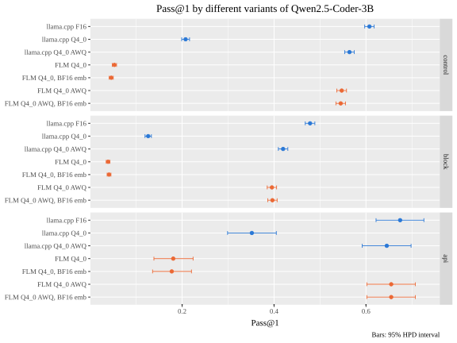

We clearly see the separation into two groups:

- The decent group, which includes the full-precision model, of course, and the
  quantised models with AWQ (on both backends).
- The bad group, which includes all quantised models without AWQ (regardless of
  the backend).

### Degradation compared to full precision

To see how much we lose compared to the full-precision model, we also
plot the difference in pass rate of the variants and the F16 model.

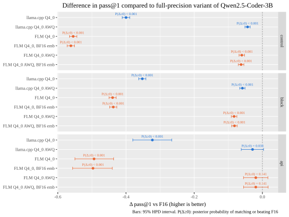

Only the models from the decent group are at least comparable in performance to
the full-precision variant. But even then, they are still noticeably worse: the
95% HPD does not contain 0, except for the API subset, but it contains far fewer
samples, which inflates the variance.

### Effect of each change

Each variant differs from the others in a few ways at once, so let's isolate the
effect of each change by comparing pairs that differ in just one thing.

#### Quantisation

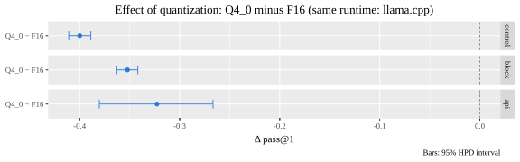

Going from F16 to plain Q4_0 on llama.cpp costs about 32--40 percentage points.
Given that the full-precision model solves about 60--65% of tasks, this is a
huge hit.

#### AWQ

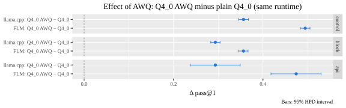

This is the big one. On the same runtime, AWQ adds about 29 to 36 percentage
points on llama.cpp and 36 to 49 percentage points on FLM. The gain on FLM is
likely to be large because we simply started closer to the bottom.

#### Embeddings

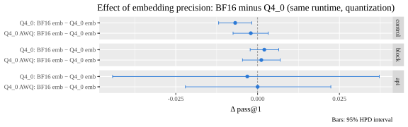

Restoring the full-precision embeddings was the first fix we tried to bring the
performance closer to the full-precision variant. But it does not seem to help:
the 0 is always within the 95% HPD range, except for the control subset on the
plain Q4_0 variant, where restoring the embeddings actually worsens the quality.
Regardless, even there, the effect is within a single percentage point. So restoring the embeddings' precision
seems to be harmless, but it does not improve anything much either.

#### Runtime

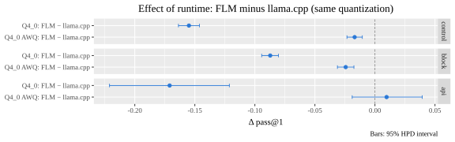

With the same weights and the same quantisation, FLM scores lower than
llama.cpp. For plain Q4_0 the gap is large: about 16 percentage points on the
control subset, 9 on the block subset and 17 on the API subset. With AWQ it
shrinks to about 2 percentage points on the control and block subsets and
disappears on the API subset. But the API subset has far fewer samples, so it is
noisier.

Note that this is with the same sampler settings on both runtimes. FLM's own
defaults for Qwen2-family models are different: a repetition penalty of 1.1, a
frequency penalty of 1.1 and top-k of 10, applied to any field the request
leaves out. My first run used them, and the AWQ variants on FLM scored slightly
worse than with llama-server's defaults, so it is worth overriding them.

So the gap is not explained by sampling. The weights are identical (FLM's Q4NX
files hold the same Q4_0 nibbles as the GGUFs), and the prompts tokenise to the
same tokens. So it seems likely that this is due to lower-precision arithmetic on
the NPU, whose errors get amplified when the weights are already damaged by
quantisation. But this is just a plausible hypothesis.

### How the variants fail

Finally, it is worth looking at _how_ the variants fail, not only how often.

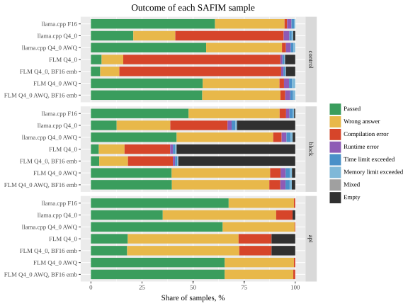

The group of the decent variants mostly fail in a "normal" way: the answer is
either correct or wrong. But in the bad group, the other failure modes are much
more common. Specifically, the code does not compile, or the variants simply
return an empty answer.

Note that "empty" here means that nothing was left after SAFIM's
post-processing. Digging into the raw outputs of the block subset, where empty
answers are the most common, the model rarely stopped right away: in 69--87% of
these cases it did generate code, but nothing of it parsed as
a valid block, so the post-processing cut it all away. The rest are mostly the
model stopping immediately or producing only whitespace. This matches what we
saw in the smoke tests: broken quantisation does not produce slightly worse
code, it produces garbage or nothing at all.

### Summary

To sum up:

- Plain Q4_0 is not usable, on either runtime, and especially not on the NPU.
- AWQ is what makes the NPU model usable: FLM Q4_0 AWQ is within a few
  percentage points of the full-precision model.
- With AWQ weights, the NPU runtime itself costs only about 2 percentage points
  compared to llama.cpp.
- Full-precision embeddings do not matter: they neither significantly improve
  the performance, nor make it worse.

## Speed

The advantage of the NPU is power efficiency, but besides the quality, speed is
another trade-off. So let's put a number on it.

llama.cpp has a built-in utility for measuring model throughput, `llama-bench`,
which I used to benchmark performance:

- across the two backends, [Vulkan and ROCm](#vulkan-or-rocm),
- for two quantisation levels,
- across input and output sizes realistic for FIM tasks.

Since FLM has no equivalent of llama-bench, we use a custom script that attempts
to replicate llama-bench's metrics on FLM.

<details style="font-size: 0.8em; color: var(--secondary);">
  <summary>One small trick we had to use ...</summary>

  ... was retrying generations that stopped early. FLM does not allow ignoring
  the EOS token, so some runs end early. Therefore, if the finishing reason
  reported by FLM is not length, we retry with a different prompt.

  Another difference compared to llama-bench is that FLM does not allow passing
  empty prompts, so we use a short (16-token) prompt before generating
  output.

  FLM also always samples, while llama-bench does not, so the script set
  temperature 0.2, top_p 0.95 and top_k 40, and turned off the repetition
  penalties that FLM's defaults add.

  Because of these reasons, the numbers are not exactly apples-to-apples, but
  rather just give a good feeling of where the backends stand in terms of speed.
</details>
<br/>

Treat these results with a grain of salt, though. I noticed that the same
parameters can yield wildly different results within the different retries of
the same experiment run. The likely culprit is thermal throttling: giving the
hardware time to cool down between runs seemed to help, and the results became
much more stable. However, I have not tested this hypothesis directly, so the
results shown here may still be affected by it, and they may only look stable
because every run was affected equally.

### F16 vs Q4_0 (on GPU)

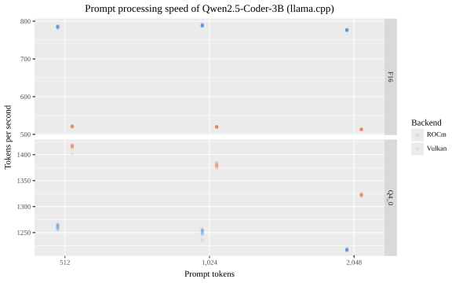

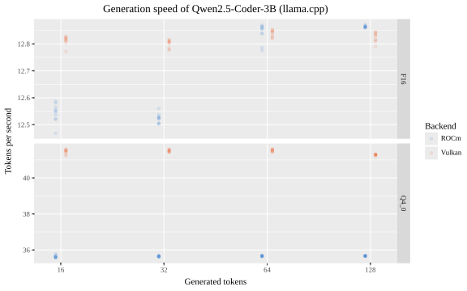

The main takeaway here is that for inline completions, which typically have long
prompts and short completions, it's prompt processing that is the bottleneck,
and ROCm is noticeably faster for the F16 variant, while Vulkan is faster for
Q4_0.

Token generation for F16, on the other hand, runs at essentially the same speed
on both backends. This suggests that it is not bound by compute but rather by
memory speed: to generate each token, all the weights have to be read from
memory, and no backend can make that faster.

FLM only runs Q4_0, so from here on, that is the variant we compare.

### Different FLM variants

First, the good news: all four FLM variants (Q4_0, Q4_0 with BF16 embeddings,
and the same two with AWQ) run at the same speed. This is expected: they all use
the same kernels and the same Q4_0 layout. AWQ only changes the values of the
weights, and the embedding lookup happens outside the NPU matrix
multiplications. Plain Q4_0 came out a bit faster on prompt
processing, but it was also the first one to run, so it could be thermal
throttling. And even if not, the differences are tiny. In other words, choosing
the more accurate AWQ variant costs nothing in speed.

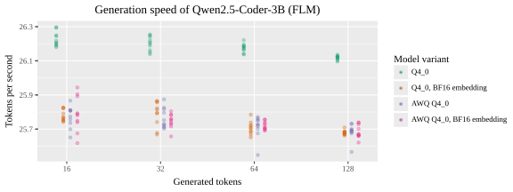

Token generation is very stable---about 26 tokens per second---and barely
dependent on the length.

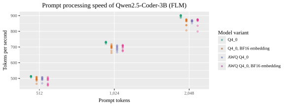

Prompt processing is more interesting. Its speed grows with the prompt length:
512 t/s for a 512-token prompt and 898 t/s for 2048 tokens.

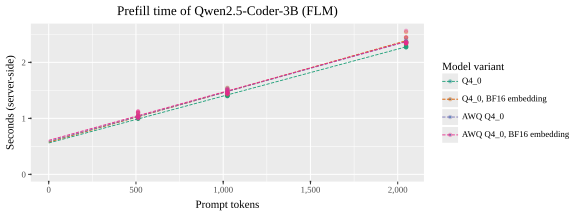

Fitting a line through the processing time against the prompt length explains
why: each request pays a fixed cost of about 0.57 seconds, and then about 0.85
ms per token, or roughly 1,150--1,190 t/s. Keep in mind, though, that this fit
is based on three prompt sizes only.

### NPU vs GPU

Here is how FLM compares to llama.cpp running the same Q4_0 model on the iGPU:

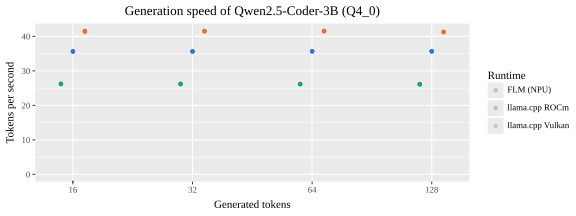

FLM generates slower than either ROCm or Vulkan.

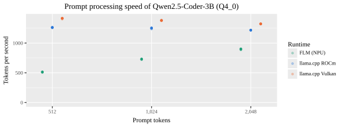

For prompt processing, the picture is more interesting. Although FLM is slower
in our tests, as the prompt length grows, the gap narrows. In fact, the marginal
speed is on par with llama.cpp on the GPU, but the fixed overhead dominates for
short prompts.

For a typical SAFIM-sized prompt of about 1,024 tokens and a 64-token
completion, a back-of-the-envelope estimate based on these rates gives about 4
seconds for FLM versus 2.5--3 seconds for llama.cpp, i.e. FLM is about 1.5 times
slower end-to-end.

So on this machine, the NPU does not win on speed. The fixed per-request cost
is especially unfortunate for inline completions, where the editor sends many
short requests as you type.

## Power draw

To measure power, I sent the same 50 SAFIM prompts, one at a time, to the AWQ
Q4_0 model on FLM and to the same weights on llama.cpp with ROCm and Vulkan.
Each request waited for the previous response plus a 7-second gap, so every
request started from idle. During each session I logged the package energy from
[RAPL](https://en.wikipedia.org/wiki/Perf_(Linux)#RAPL), which covers the CPU
cores, the iGPU and the NPU. After each session I logged an idle run with the
model still loaded and used it as the baseline: about 4.4 W for all three
backends, the same as with no server running at all.

### Power

Looking at the power alone, the NPU wins easily. During prompt processing,
FLM draws on average 8 W above idle, while llama.cpp draws around 42 W on
Vulkan and 43 W on ROCm.

The NPU wins on generation too: it draws about
10 W above idle, while Vulkan and ROCm draw about 28 W and 46 W respectively.

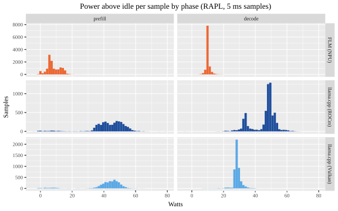

But we already know that the NPU is slower. A request takes FLM about
2.4 seconds, compared with 0.8--1 second on llama.cpp (these requests are
shorter than in the estimate above, so FLM's fixed cost weighs more). Lower power for a longer
time does not necessarily mean less energy.

### Energy

It does here, though, just with a smaller margin. FLM spends 22 J per request
above idle, compared with 28 J on Vulkan and 44 J on ROCm.

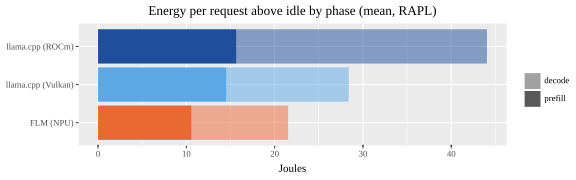

Per token, the picture is similar. Prompt processing costs 20 mJ per token on
FLM and 27--29 mJ on llama.cpp. Generation is where the difference is larger:
0.44 J per token on FLM, 0.69 J on Vulkan and 1.3 J on ROCm.

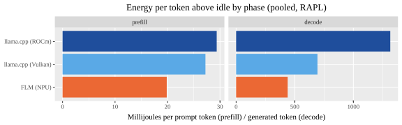

So the NPU sounds like a clear winner. However...

### Power after the response

There is a catch. After the response is sent, the GPU drops back to idle within
a second (Vulkan almost immediately). The NPU does not: it stays about 2.4 W
above idle for another 6 seconds, and only then drops.

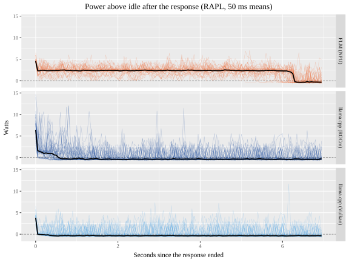

2.4 W is not much, but over 6 seconds it adds up to about 15 J, which is more
than half of what the request itself costs. With it, FLM spends 37 J per
request, and thus, Vulkan, which spends 29 J including its own short tail, becomes the most efficient.

So the answer is: _it depends_. If the requests come back-to-back or
in quick succession with gaps below 3 seconds, FLM could be the most efficient. But
if the requests are more spaced in time, then Vulkan is our winner.

Keep in mind that this is a single run per backend, and that RAPL measures the
whole package, but not the DRAM. Generation is memory-bound, so the true cost
per token is somewhat higher for all three backends than the numbers above.

## Conclusions

So, can you get inline suggestions from a model running on an AMD NPU? Yes. FLM
does not ship a FIM-capable model, but Qwen2.5-Coder-3B has the same
architecture as the officially supported Qwen2.5-3B-Instruct. So we can borrow
the kernels of the latter and swap in the weights of the former.

Getting there was a bit trickier than it sounds, though. Along the way we had to

- **Change the quantisation.** The official model card says Q4_1, but the
  kernel expects Q4_0.
- **Expand the EOS tokens.** The Instruct model's config does not stop on the
  FIM tokens, so they leak into the completions. Adding them and a few others to
  the EOS set fixes that.
- **Do activation-aware weight quantisation.** Plain Q4_0 runs, but the
  completions are mostly unusable. AWQ, which is what the official model seems
  to use too, brings most of it back.

And one thing that did not matter: restoring the full-precision embeddings. It
is free, so I'd keep it, but it does not change the quality in either direction.

**Quality** turned out to be surprisingly good. The FLM AWQ variant is 6, 8 and
2 percentage points behind the full-precision model on llama.cpp (control, block
and API subsets, respectively), and only about 2 percentage points behind the same AWQ
weights on llama.cpp.

**Speed** is where the NPU loses. It generates at about 26 tokens per second,
which is about 70% of what llama.cpp does on the iGPU, and every request pays a
fixed cost of about half a second before it even starts processing the prompt.
End-to-end, a typical completion takes about 1.5 times longer than on the GPU.
For inline suggestions this is quite noticeable.

**Power** was the whole reason to bother with the NPU in the first place. And
the conclusion is that it depends. It depends on how often the requests are
firing. If they are firing very frequently, then FLM is the clear winner among
our backends. But if the requests are firing less often than once every 3 seconds, Vulkan
becomes a more power efficient option.

So, would I use it? Probably not. Not because it doesn't work: getting a FIM
model onto the NPU took more effort than I expected, but the result is usable,
and the quality loss is smaller than I feared. It was also a fun journey, along
which I learnt some new concepts and had to look under the hood of tools I had
only ever used as black boxes. But subjectively, even though the suggestions
make sense, they are rarely relevant enough for me to accept them, and the
latency, especially on the NPU, is hard to miss. Still, for edge cases like an
air-gapped or airplaned (pun intended) laptop, it is definitely better than
nothing!

## What next

This post is a "proof of pipeline", so there is plenty left to try.

**Better weights for the same kernel.** Everything that changes only the
weights, and not the architecture, reuses the exact pipeline and kernel from
this post:

- _A better calibration set for AWQ._ The Pile is mostly prose. Calibrating on
  code, ideally on FIM-formatted prompts, might help preserve the
  code-sensitive channels.
- _Fine-tuning._ Changing weights without touching the architecture is possible.
  And the point above suggests using a code-specific dataset for AWQ. Why not go
  a step further and fine-tune on the FIM-specific dataset? Especially, because
  there is some evidence that FIM fine-tuning can help Qwen2.5-Coder ([Gong et
  al., 2025](https://arxiv.org/abs/2505.18789)).
- _Existing community fine-tunes._ There are already a few FIM fine-tunes of
  Coder-3B on Hugging Face, so we can skip the previous step and use those.

**Other model sizes.** Qwen2.5-Coder also comes in 0.5B, 1.5B, 7B, 14B and 32B.
A smaller model would help with the speed, which is the NPU's weak spot here,
and a larger one with the quality. The problem is that the approach described
here requires the exact same architecture, and FLM ships Qwen2.5 only in one
size: 3B. So within Qwen2.5, we are stuck at 3B, which also rules out fine-tunes of
other sizes, like [Sweep
Next-Edit](https://huggingface.co/sweepai/sweep-next-edit-1.5B) (1.5B) or Zed's
[Zeta](https://huggingface.co/zed-industries/zeta) (7B).

**Other model families.** FLM has a wider choice in newer families. For example,
it ships Qwen3 at 0.6B, 1.7B, 4B and 8B, Llama 3.2 at 1B and 3B, and Gemma 3 at
1B and 4B. None of these are FIM models out of the box, but any FIM model that
shares the shape of one of them is a candidate for the same trick. One potential
lead is [TIGER-Lab's
FIM](https://huggingface.co/collections/TIGER-Lab/fim-midtraining) model built
on Qwen3-8B.

To be clear, these are ideas rather than a plan, and I have not tried any of
them yet. But it would be interesting to go ahead and explore them, wouldn't it?
